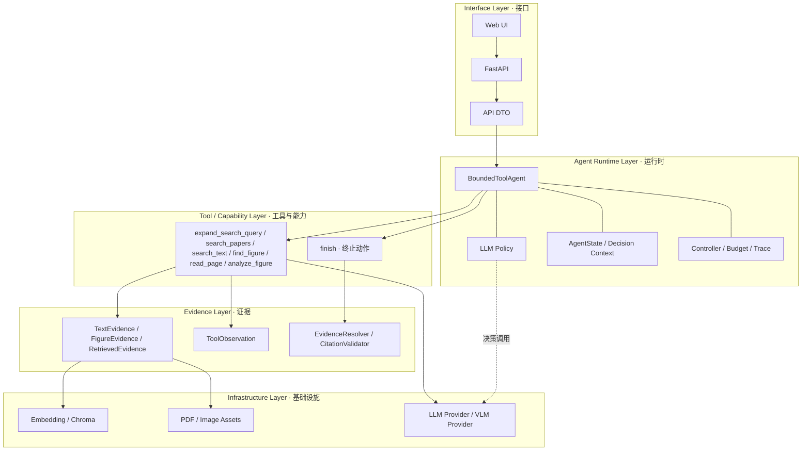
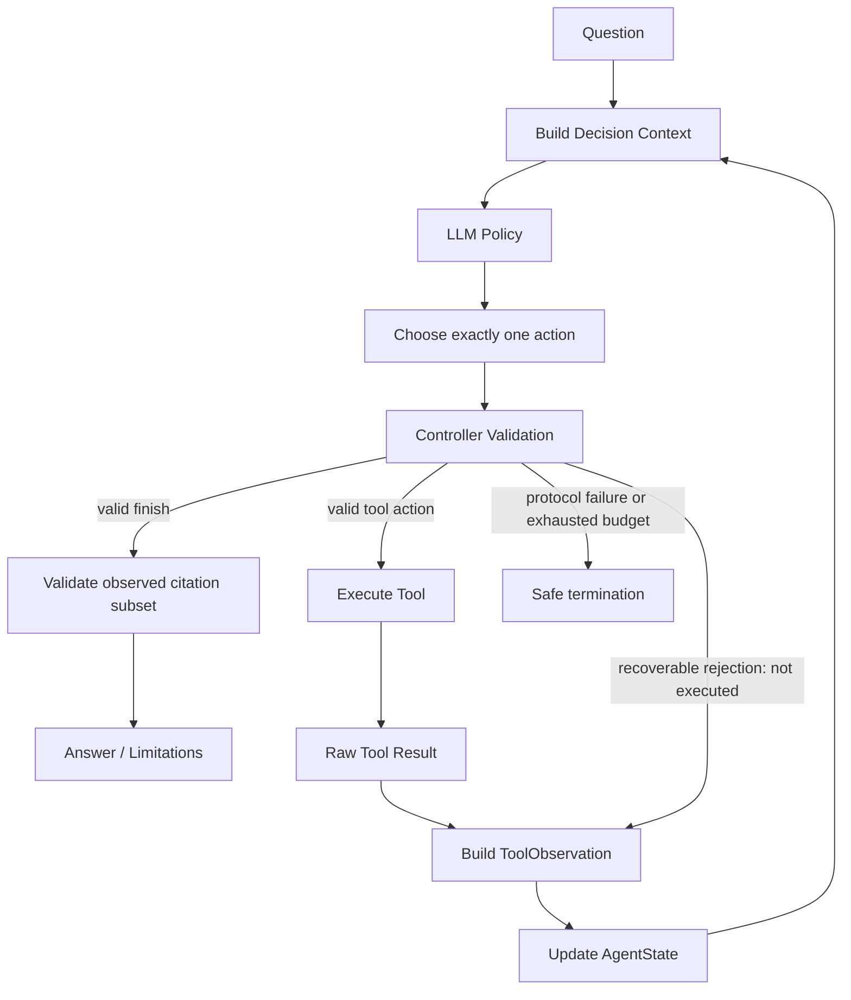
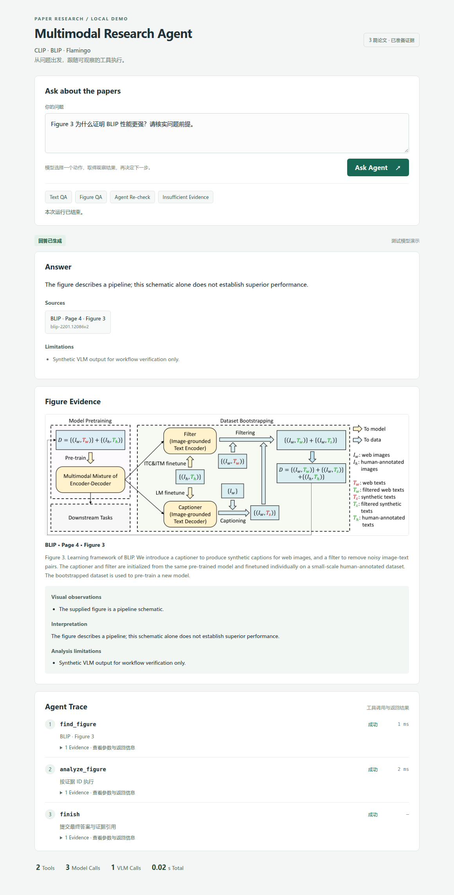
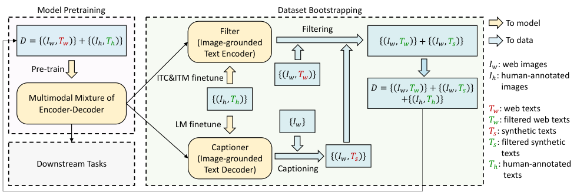

# Multimodal Research Agent

**一个有限步的多模态论文研究智能体：检索论文文本、分析 Figure，并根据可追溯证据决定下一步调查或结束回答。**

> A bounded multimodal research agent that retrieves, analyzes, and reasons over text and figures in scientific papers with traceable evidence.

这是面向 **CLIP、BLIP、Flamingo 三篇论文的证据约束问答与 Agent 决策原型**。V0.1 已封板；V0.2 增加论文发现、模型控制的查询扩展、离线论文画像和独立研究规划，它不是通用自主科研系统。

| 核心能力 | 如何体现 |
| --- | --- |
| **Retrieve · 找证据** | 模型为明确指定的论文选择 `paper_ids`，检索器在检索前应用范围过滤 |
| **Understand · 读图** | 将 Figure、caption 与已准备的页面文本一起交给 VLM，分开记录观察与解释 |
| **Decide · 选动作** | 模型看到每轮 Observation 后，自主选择工具、补充上下文或调用 `finish` |

**当前规模：25 篇论文发现元数据；其中 3 篇具备 25 条 TextEvidence、3 条 FigureEvidence。V0.1 冻结评测集仍为 40 题。** V0.1 基线为 **257 passed**；当前全量 **646 passed**（2026-10-08）。真实 Demo 与模拟验证分别标记；完整三系统正式比较尚未完成。

快速阅读：[架构](#系统架构) · [三个-demo](#三个-demo) · [失败分析](#失败分析) · [快速开始](#快速开始) · [限制](#当前限制)

## V0.2 Phase 1 · 论文发现

开放问题可先调用 `search_papers` 发现候选论文，再由模型选择 `paper_ids` 调用 `search_text`。
已知论文问题直接使用 scope；发现元数据不等于可引用正文。未准备正文的候选返回结构化 unavailable/empty，不生成虚假 Evidence。

新增独立 Paper Index，复用既有 Qwen Embedding/Chroma；原始表示下 8 条开发查询的真实宏平均 Recall@5=0.8708、Recall@10=0.8958。fixture 摘要为来源摘要简述，keywords 为空，开发相关性标签尚非正式人工 Ground Truth。详见 [Phase 1 实现与运行说明](docs/paper-discovery.md)。

```bash
python -m scripts.ingest_papers --device cpu
python -m eval.paper_discovery --output artifacts/paper-discovery-evaluation.json
```

索引就绪后在 `.env` 设置 `AGENT_PAPER_DISCOVERY=1` 并重启服务；默认 0 保留 V0.1 模式。不引入 Multi-Agent/Planner/Reviewer 或并发运行时。

## 智能体控制的多查询发现

新增 `expand_search_query`：只生成最多两条保持原意的检索查询，不自动检索。每请求最多调用一次，由模型根据原查询的 Observation 判断是否需要；Controller 只验证参数、重复与预算。
候选按 paper_id 取并集，Trace 的 retrieved_paper_ids 保留 Query → Papers 关系，不混入 Evidence 引用。

增强论文表示之前的首次八题真实评测中，ExpansionRate=37.5%，额外 26 次 LLM / 4 次 Embedding 调用，Recall@5/10 仍为 0.8708/0.8958；InstructBLIP 和 OFA 未被新增查询召回。这是历史运行记录，未在本次表示增强后重跑多查询比较。固定 shortlist 与各查询并集覆盖分开统计，没有包装为提升。
详见 [多查询发现设计、指标与真实结果](docs/query-expansion.md)。

## 离线结构化论文画像

`PaperProfileExtractor` 只读取当前标题和摘要，生成 `tasks / methods / capabilities`，每字段最多 5 项。输出必须通过结构校验和原文片段存在性校验；失败回退为空画像，查询时不调用抽取模型。

统一索引文本使用 `Title / Abstract / Tasks / Methods / Capabilities / Keywords` 字段标签。缓存按标题、摘要和抽取版本匹配，复用成功的画像；原始 fixture、Gold、Embedding Model 和 PaperRetriever 算法均不变。

```bash
python -m scripts.ingest_papers --enrich --env-file .env --device cpu \
  --profile-cache artifacts/paper-profiles.json --report artifacts/paper-enrichment.json
python -m eval.paper_discovery --output artifacts/paper-discovery-enriched.json
```

首次真实抽取：24/25 篇生成非空画像，1 篇校验失败回退；25 次 LLM 调用、约 43.99 秒。相同八题单查询 Top-10 评测中，Macro Recall@5 保持 87.08%，Recall@10 从 89.58% 到 95.83%；OFA 在 discovery-08 原查询下由第 13 名到第 7 名，InstructBLIP 在 discovery-03 仍为第 15 名。此比较同时改变字段标签和画像内容，未分别测量二者贡献，也不证明普遍性能提升。详见 [画像准备、复用和前后评测](docs/paper-profiles.md)。

## 独立研究规划与证据需求

`ResearchPlanner` 将问题与已验证的候选论文转换为最多 8 个动态研究维度，不预测论文答案。程序确定性展开 `Papers × Dimensions`，生成 pending 的 EvidenceRequirement，再按 paper_id 分成 WorkerTask；本阶段只生成任务，不执行 Worker，也未接入现有 API/Agent Loop。

`supported` 必须有 claim 和 evidence_ids；`insufficient_evidence` 是已解决的合法结果。研究完成由所有需求 resolved 决定，Coverage 单独表示有证据支持的比例。Trace 记录数量、维度 ID、调用和安全失败详情，不保存系统提示或隐藏推理。

```bash
python -m scripts.smoke_research_planner --env-file .env \
  --output artifacts/research-planner-smoke.json
```

最终三个真实 smoke 分别生成 5/5/4 个维度、15/15/8 条需求和 3/3/2 个 WorkerTask，每题一次模型调用。窄成本问题没有独立的下游性能维度；广问题的描述仍含可能引导答案的例子，记录为语义警告。该验证不等于 Worker 执行或中立性的普遍保证。详见 [Planner 契约与真实验收](docs/research-planner.md)。

## 有界异步 Research Worker Pool

已有 ResearchPlan 可展开为逐论文 WorkerTask，再由 `AsyncResearchOrchestrator` 并发执行。每个 Worker 在共享论文上下文中逐项或批量解决需求，复用已观察证据；没有为每条需求重启 Agent。`supported / insufficient_evidence` 是研究结果，`execution_failed / cancelled` 保留执行故障和取消语义。

Worker 槽、LLM/VLM/Retrieval 资源槽分别限流。同步 Provider 和冻结 ToolExecutor 在集中线程适配边界调用，原生 async 直接 await；只有明确瞬态故障进行有界重试。取消沿 asyncio Task 传播，保存已有结果并重新抛出 CancelledError；取消线程等待不保证线程立即停止。

一次模型响应包含多个动作时，Controller 整批拒绝执行，将结构化协议反馈交给下一轮 Policy。每个 Worker 默认最多提供两次纠正机会；拒绝消耗模型预算，不消耗工具预算，纠正耗尽时保留已有结果。该机制独立于 Provider 的瞬态重试，另有 19 项确定性回归测试。

```bash
# 复用已生成的 Planner 结果；本阶段没有代使用者执行真实 Worker smoke。
python -m scripts.smoke_async_research --plan artifacts/research-planner-smoke.json \
  --case-id planner-smoke-01 --validate-only --output artifacts/worker-plan-validation.json
# 去掉 --validate-only 后才会调用真实模型并执行 Worker。
```

Worker Pool 初始阶段新增 101 项 Fake/确定性测试，包括 10 Workers / 上限 3 的真实重叠、独立资源峰值、共享证据、故障隔离、取消、重试及物理预算。它们验证工程行为，不是正式研究性能结果。现有 API/UI 未切换到 Worker Pool；该初始阶段尚无 Reviewer 或跨论文 Synthesis。详见 [Worker Pool 接口、指标和真实运行方式](docs/async-research.md)。

## 需求中心状态与独立证据审核

Worker 按需求记录候选证据、逻辑搜索次数和最后新增数，显式区分 resolved/unresolved。候选只表示调查来源；语义充分性和 resolution 仍由 Policy 决定。相同原计划和预算的 Flamingo 工程回归从 protocol_correction_exhausted 变为 completed，恢复额度保持 2，5 条需求显式 supported；它们仍需独立审核，不能仅凭身份校验当作正确答案。

`DeterministicReviewValidator → EvidenceReviewer → ReviewResult` 先验证结构、当前 Corpus 身份、同论文来源和 Worker 观察账本，再审核完整 claim 的语义支持。Reviewer 没有研究工具，不改 claim、不搜索、不生成跨论文答案。审核以固定数量消费者与独立 Reviewer/LLM 配额执行；语义 rejected 不重试，Provider 失败保持 typed not_reviewable；不足和执行失败跳过模型。

Stage A 新增 21 项、Stage B 新增 69 项确定性测试。一次真实审核中，Flamingo 5 项 passed、5 次模型调用、0 重试；BLIP-2/LLaVA 10 项 insufficient 全部跳过，0 Reviewer 调用。此结果只验证工程链路，不是模型正确率 Benchmark；现有 API/UI 未接入审核，也没有 Reviewer→Worker 恢复。独立综合由下文 Stage C 提供。详见 [审核架构、契约与运行方式](docs/evidence-review.md)。

## 严格证据驱动的结构化综合报告

Stage C 增加 `ResearchPlan → WorkerResult → ReviewResult → SynthesisInput → ResearchReport`。只将验证通过且审核 passed 的原主张交给模型组织章节与合法引用，正文、来源和完整 Paper × Dimension 缺失矩阵由程序组装。被拒绝正文不进入事实上下文；重复审核返回结构化错误，不任意选择 passed。

模型/协议/预算失败时保留最小确定性报告，明确标为 generation_degraded；无已审核证据是合法不足报告，不调用 Provider；取消保持 cancelled 并传播。第一版不生成自由技术摘要或未经审核的胜负/等价关系，比较仅为同维度已验证主张并列，没有新研究循环、API/UI 接入或 Reviewer→Worker 恢复。

复用 Stage A/B 的一次真实综合：3 篇×5维度、5 条 Flamingo 原主张、10 个不足单元；1 次模型调用、0纠正/重试，约10.49秒。生成成功率1/1，但 EvidenceCoverage仅5/15。同一输入的受控 Fake 引文违规演示被单独标记，预算耗尽后保留5条事实及10个缺失格。新增64项测试，原582项保留。详见 [综合契约、指标与运行方式](docs/research-synthesis.md)。

## 为什么做这个项目？

Text RAG 能找到相关段落，但论文问题可能要求读取具体 Figure、理解图注、补充所在页的上下文，或核实问题前提。一次固定检索与生成不一定覆盖这些信息需求。

本项目从已有 Personal RAG 的文本检索契约出发，加入图像证据与固定多模态 QA，再发展为可观察的 Agent Loop。**Agent 的价值在于按当前证据选择下一动作，而不是让所有问题都执行更多步骤。** 简单文本题应及时结束；图像题可以补读页面；证据不足时应说明限制。

系统同时保留 Text-only RAG、Fixed Multimodal RAG 与 Multimodal Agent 的统一接口，便于以后比较质量与成本。目前没有证据证明 Agent 在所有任务上优于固定 RAG。

## 关键能力

- **论文范围检索**：`search_text(query, paper_ids, top_k)`；工具契约要求明确论文问题使用对应 scope。选择由模型完成，Controller 不按关键词自动填论文 ID。
- **定位与补上下文**：`find_figure(paper_id, figure_id)` 精确定位准备好的图；`read_page(paper_id, page)` 读取已准备区域，未准备页返回 empty。
- **视觉证据分析**：`analyze_figure(question, figure_evidence_id, context_evidence_ids)` 通过 EvidenceResolver 解析证据，再复用 FigureAnalyzer；调用方不能传任意图片路径。
- **明确结束与引用验证**：`finish(answer, evidence_ids, limitations)` 校验引用只来自本次实际观察过的证据。
- **可观察执行**：本地 Web UI 展示答案、来源页码、Figure、分析、Trace 和调用指标；Trace 不展示隐藏 Chain-of-Thought。
- **有限步恢复**：重复搜索拦截、非法参数纠正反馈、empty/error 区分和程序控制的预算，约束失败的影响范围。

## 系统架构



图示表达依赖职责，不要求每次问答都经过所有基础设施。`day5-controlled` 演示检索不加载 Embedding/Chroma；`real` 检索才使用它们。`finish` 是 Controller 验证的终止动作，不计领域工具执行数。

## Agent 如何工作？



用简化记号表示当前问题、观察历史和预算：

$$s_t=(q,O_{1:t},B_t),\qquad C_t=h(s_t),\qquad a_{t+1}=\pi_\theta(C_t).$$

`h` 从现有状态派生轻量上下文：已观察证据摘要、论文目录、历史动作/失败与剩余预算。完整 ToolCall 和 Observation 保持标准消息配对，真正回传模型；Controller 校验模型提出的动作后才执行。

## 三个 Demo

以下展示故事不是固定执行策略。状态区分 **Real verified**（已有真实调用记录）、**Scripted/Fake verified**（模拟链路验证）、**Documented only**（问题已定义但未实际运行）。[公开记录与边界](docs/demos/README.md)保留原问题、来源文件 hash、实际工具路径和引用。

<details>
<summary>查看界面截图（Fake 模型，仅验证展示与执行链）</summary>



截图由已有浏览器检查生成，使用 Scripted LLM、Fake VLM 和受控检索；所示耗时不作为真实 API 成本。

</details>

### Demo A · CLIP Text QA

```text
What training objective does CLIP use to align images and text?
```

**Real verified：一次历史真实模型运行，检索后端为受控演示。** [实际记录](docs/demos/clip-text-real.json)：

```text
search_text(paper_ids=["clip-2103.00020v1"])
→ CLIP TextEvidence
→ finish
```

记录为 1 次工具、2 次决策模型调用、0 次 VLM；最终引用来自 CLIP PDF 第 2、4 页。答案描述图文配对的 contrastive objective。它展示实体落地、范围检索、证据引用和及时停止；不证明真实向量检索质量或稳定成功率，也不代表没有进一步人工审阅的空间。

### Demo B · BLIP Figure Understanding

```text
Explain Figure 3 of BLIP and its role in the CapFilt pipeline.
```

**Documented only：这个确切问题尚无对应真实运行记录。** 演示目标路径为：

```text
find_figure → read_page → analyze_figure → finish
Figure + Caption + Page Context → VLM Analysis
```

已有[真实固定流程记录](docs/demos/blip-fixed-vlm-real.json)使用同一张 Figure 3 和页面证据，但问题是核实“是否证明性能更强”，不冒充本题已执行，也不把固定流程描述成自主 Agent 路径。

BLIP Figure 3 位于 PDF 第 4 页，展示 CapFilt 的 captioner、filter 与数据自举流程。



**Observation ≠ Interpretation**：可见的模块和箭头属于观察；对训练机制与效果的解释应限定在图注和已提供文本支持的范围内。

### Demo C · False Premise

```text
Why does Figure 3 prove that BLIP achieves better performance?
```

**Real verified：历史真实 Agent 已运行中文等价问题**“Figure 3 为什么证明 BLIP 性能更强？请核实问题前提。”，[原始路径摘录](docs/demos/blip-false-premise-real.json)为：

```text
search_text → find_figure → search_text → read_page
→ search_text → analyze_figure → finish
```

实际为 6 次工具、7 次决策调用、1 次 VLM。最终识别 Figure 3 是 CapFilt 流程图，不是性能对比图；图中没有支持“性能更强”的定量证据。

这条历史路径也包含额外性能搜索，不能将其包装为最优效率或完全没有 Scope Drift。应展示的决策原则是：核查当前 Figure 能支持什么，而非转向无关 benchmark 来迎合前提。

$$\text{Correct Evidence}\neq\text{Correct Answer to Intent}$$

证据身份合法仍可能答错用户的问题。Fake 行为测试另验证 `find_figure → analyze_figure → finish` 与补读上下文路线，但不作为真实理解质量证明。

## Agent Engineering

### 1. Evidence 是一等对象

`TextEvidence` 和 `FigureEvidence` 保存来源；`RetrievedEvidence` 单独保存查询相关分数。固定版本、页码、模态和内容生成稳定 ID；同源重复 ingestion 通过 upsert 避免重复记录。

```text
Claim → EvidenceID → paper_id → PDF page → original text / figure + caption
```

加载时校验 PDF、页面文本和图片 hash；页码指从 1 开始的 PDF 页序号。VLM 引用必须满足 `E_used ⊆ E_provided`，最终引用必须满足 `E_finish ⊆ E_observed`。**身份校验不能替代语义支持性检查。**

### 2. LLM Policy 与 Controller 分工

| LLM Policy：语义决策 | Controller / 工具执行边界：确定性约束 |
| --- | --- |
| 哪篇论文？证据是否充分？需要 Figure 或更多上下文吗？何时 finish？ | 单动作协议、参数 Schema、合法论文/证据 ID、预算、重复动作拦截、引用子集校验 |

Decision Context 提供 metadata 派生的 Corpus Catalog；模型按工具契约选择 `paper_ids`。没有 `if "CLIP" in question` 的自动范围改写；语义契约不是 Controller 的实体识别实现。

### 3. Observation 设计

`RawToolResult ≠ AgentObservation`。模型接收的是执行反馈与决策相关信息，包括证据、来源、状态和恢复建议。

- `success`：有证据；`empty`：调用完成但无证据；`error`：参数、依赖或内部故障。
- 未知论文反馈提供合法版本 ID，模型自行纠正；empty 可以改 query、换来源或说明不足。
- 重复搜索沿用公开 `error` 状态，`issue_code=redundant_action`，明确 not executed；不增加实际工具计数。
- Trace 只记录动作、参数、状态、延迟和证据，不保存隐藏推理。

### 4. Bounded Execution

默认最多 **6 次工具执行、7 次主策略模型决策**，包含最后一次 finish 机会。查询生成最多额外一次 LLM 请求，单独计数且计入总模型调用指标。拦截请求占决策机会而不占工具执行预算。相同参数连续失败还有单独的停止保护。

近重复搜索只比较本轮成功取得证据的搜索：规范化 query、同论文 scope、同 K，Jaccard 阈值为 0.85；改变 scope/K 或明显不同信息需求可继续执行。不自动 finish，也不使用 Embedding 判重复。

预算是 **Failure Containment**，不是成功停止条件。系统可能在预算内失败，不能声称“总能在六步内解决问题”。

## 失败分析

[历史 CLIP 错范围案例](docs/demos/clip-wrong-scope-real.json)：

```text
问题明确指定 CLIP
→ search_text(paper_ids=null)
→ 全库受控检索得到 BLIP evidence
→ 再搜索仍得到同一组证据
→ 引用合法、但未满足 CLIP 的问题
```

**这条失败记录不是 Vector Store 出错：模型没有将论文实体落实为工具范围。** 该后端本就不是语义向量排名；问题首先出在 `NamedEntity ↛ ToolScope`。其他历史运行还出现 `step_exhaustion`，进一步说明执行 completed 和引用合法都不等于任务成功。

Day 9.5 强化 scope 契约并加入目录后的[单题记录](docs/demos/clip-text-real.json)显示：

```text
Corpus Catalog → Decision Context → LLM 选择 CLIP ID
→ paper_ids=["clip-2103.00020v1"] → scoped retrieval → finish
```

**LLM interprets; Controller validates.** 这是一条可检查的行为改善记录，不是统计性的优化效果结论。近重复阈值没有为此案例调低，检索器和语料未因该失败修改。

## 评测说明

冻结集在 [eval/datasets](eval/datasets)，经过用户核对并批准；静态校验通过不等于系统答案评分通过。

| 类别 | Dev | Test | 总数 |
| --- | ---: | ---: | ---: |
| Text QA | 3 | 7 | 10 |
| Figure QA | 3 | 9 | 12 |
| Cross-paper QA | 2 | 8 | 10 |
| Insufficient Evidence | 2 | 6 | 8 |
| 总计 | 10 | 30 | 40 |

三系统统一 `run(case) → EvaluationRun`：Text-only RAG、Fixed Multimodal RAG、Multimodal Agent。记录答案、引用、证据、状态、耗时与调用数。完整协议见 [eval/README.md](eval/README.md)。

**Full three-system benchmark execution has not been completed.** 历史执行过 10 dev × 3 系统的真实模型探索，检索为 day5-controlled；30 条 test 的三系统正式比较与完整人工语义评分未完成。Fake Results 只验证执行链，不能推导性能。

预留指标为 Retrieval Recall@K、Citation Correctness、Task Success、Execution Cost。当前 Figure Recall 衡量前 K 个取得的 Figure 覆盖率，不是图像向量排名；引用 ID 命中率不等于语义正确性。尚未评分的语义指标为 null。12 道 Figure 题共享 3 张图，不能当作 12 个独立图像样本或严格 IID 泛化结果。

## 项目结构

```text
app/
├── papers/      # 论文领域模型、发现目录与独立索引
├── research/    # 动态研究维度、证据需求、待执行任务及完成统计
├── agent/       # 有限步循环、决策上下文、恢复、finish
├── tools/       # 工具契约、注册、执行器、Observation
├── evidence/    # fixture、来源校验、证据解析与引用校验
├── retrieval/   # Embedding、Chroma、论文范围文本检索
├── vision/      # VLM 适配器与 FigureAnalyzer
├── qa/          # 固定多模态 QA 服务
├── api/         # FastAPI 路由、DTO、资源组合
├── web/         # 轻量 HTML/CSS/JavaScript UI
└── main.py      # 服务入口

data/
├── paper_discovery/  # 25 篇元数据与 8 条开发查询
├── fixture_configs/  # 人工 region/crop 配置
├── papers/           # CLIP、BLIP、Flamingo 的固定 PDF/metadata/pages/figures
└── smoke/            # 跨论文检索冒烟问题

eval/            # 冻结数据、统一 Runner、指标与汇总
scripts/         # fixture 准备、ingestion、演示与检查
tests/          # 单元和集成测试
docs/demos/     # 明确标注真实性的历史 Demo 摘录
```

## 快速开始

以下命令从**仓库根目录**运行，面向 Python 3.11+ 与 Bash；没有开发者机器路径。Windows 可用 WSL 执行同一流程。本项目目前以源码检出运行，不宣称任意工作目录的独立 wheel 已验证。

### 1. 创建环境并安装依赖

```bash
python3 -m venv .venv
source .venv/bin/activate
python -m pip install --upgrade pip
# CPU 环境先安装对应 PyTorch，避免无意下载 CUDA 运行库。
python -m pip install "torch>=2.5,<3.0" --index-url https://download.pytorch.org/whl/cpu
python -m pip install -e ".[test,api,llm,vision,data,retrieval]"
```

可选依赖在 [pyproject.toml](pyproject.toml)。上述包含本地 Chroma 集成测试依赖；没有安装 Chroma 时相关测试会跳过，不能把较少的通过数量当成完整验收。真实检索首次加载 Qwen 模型会下载权重，CPU 可运行但较慢。

### 2. 配置模型

```bash
cp .env.example .env
# 编辑 .env，填写 LLM_API_KEY/MODEL/BASE_URL 与 VLM_API_KEY/MODEL/BASE_URL。
```

`.env` 已被 Git 忽略，模板密钥为空。LLM 必须支持 function/tool calling；VLM 必须支持图片输入及严格 JSON 输出。两者可以使用不同提供方。是否兼容以实际 smoke 为准，VLM 返回多余字段也会被严格解析拒绝。

模板默认 `AGENT_RETRIEVAL_BACKEND=day5-controlled`，是固定证据的演示检索。**真实 LLM + 受控检索不等于全真实 RAG。** 使用语义检索时在 `.env` 设置 `AGENT_RETRIEVAL_BACKEND=real`。

### 3. 校验语料与准备索引

仓库已包含固定 PDF 与准备好的证据，首次启动不需要重建：

```bash
python -m scripts.ingest_corpus
python -m eval.validate_dataset --require-reviewed
```

第一条默认只校验并显示各论文证据数量，不加载 Embedding。若使用 `real` 后端，先执行：

```bash
python -m scripts.ingest_corpus --execute --device cpu \
  --embedding-model Qwen/Qwen3-Embedding-0.6B --index-dir data/chroma/day2
```

`.env` 中的模型、device、索引目录必须与 ingestion 一致；集合为 `papers-day2-text`。重复 ingestion 使用 upsert。语料/模型/维度改变时应使用新的索引目录。

如需从固定 PDF 重建人工 fixture，可显式运行（不是自动 PDF Parser）：

```bash
python -m scripts.prepare_paper_fixture \
  --config data/fixture_configs/blip.json \
  --pdf data/papers/blip/paper.pdf --output data/papers/blip
```

### 4. 启动服务与打开 UI

```bash
AGENT_ENV_FILE=.env python -m uvicorn app.main:app --host 127.0.0.1 --port 8000
```

打开 [本地 UI](http://127.0.0.1:8000) 或 [API 文档](http://127.0.0.1:8000/docs)。配置缺失时 UI 仍可打开，问答 API 会返回稳定的 unavailable 错误，不能将页面可见当成模型已配置成功。

```bash
curl -X POST http://127.0.0.1:8000/api/agent/run \
  -H 'Content-Type: application/json' \
  -d '{"question":"What training objective does CLIP use to align images and text?"}'
```

返回 DTO 含 `status / answer / citations / limitations / trace / metrics / figures`；引用由后端提供 paper/page/figure。请求会调用模型，可能返回安全失败或步数耗尽。

### 5. 不调用真实模型的验证

```bash
python -m pytest -q
python -m eval.smoke
python -m scripts.demo_day5 --output-dir artifacts
```

`eval.smoke` 固定 1 dev case × 3 Fake systems；`demo_day5` 演示文本、Figure、证据不足后调整、预算耗尽四条脚本路线。模拟结果只验证连线。

输出默认在 Git 忽略的 `artifacts/`，可用 `--output-dir` 指定位置。已有真实单题复查入口见 [eval/README.md](eval/README.md)，需使用者显式运行；作品集打包没有触发新的真实模型调用或完整 Benchmark。

## 当前限制

1. **语料受控**：发现目录有 25 篇，但正文仍仅 3 篇论文、人工选择的页面区域；`read_page` 不是整页或任意 PDF 阅读器。
2. **Figure 人工准备**：每篇 1 张关键图，裁剪与图注由固定版本配置并人工检查；无任意 PDF 自动 Figure Extraction。
3. **没有图像向量检索**：Figure 主要按论文 ID 与图编号定位，返回 caption；没有任意图片相似度搜索或跨模态向量排名。
4. **动作空间有限**：V0.1 使用四个领域工具和 finish；V0.2 显式启用论文发现后增加 search_papers 和受限的 expand_search_query。calculator 不属于论文 Agent 动作集。
5. **有限步不保证成功**：可能协议失败、依赖失败、重复失败或预算耗尽；严格引用校验不保证语义正确。
6. **单 Agent**：没有 Multi-Agent、Planner/Executor 双 Agent 或 LangGraph Runtime。
7. **检索模式需区分**：默认演示是受控检索；真实 Embedding/Chroma 必须显式安装、ingest 并启用。
8. **评测未闭环**：完整三系统正式比较未执行，人工语义评分未完成；不发布 accuracy 提升或 Agent 优于 RAG 的结论。

固定论文资产沿用原论文来源，详见各 [metadata.json](data/papers)。项目是工程与学习原型，不宣称论文素材的原创权或统一再分发许可。

## 后续方向

- **Automatic Scientific PDF Parsing**：自动识别科学论文正文、图表与结构，并延续来源校验。
- **Multimodal / Cross-modal Retrieval**：在统一证据契约下研究图文检索与排序。
- **Graph-based Agent Runtime**：若任务复杂度需要，再评估 LangGraph 等图运行时；**当前未使用**。
