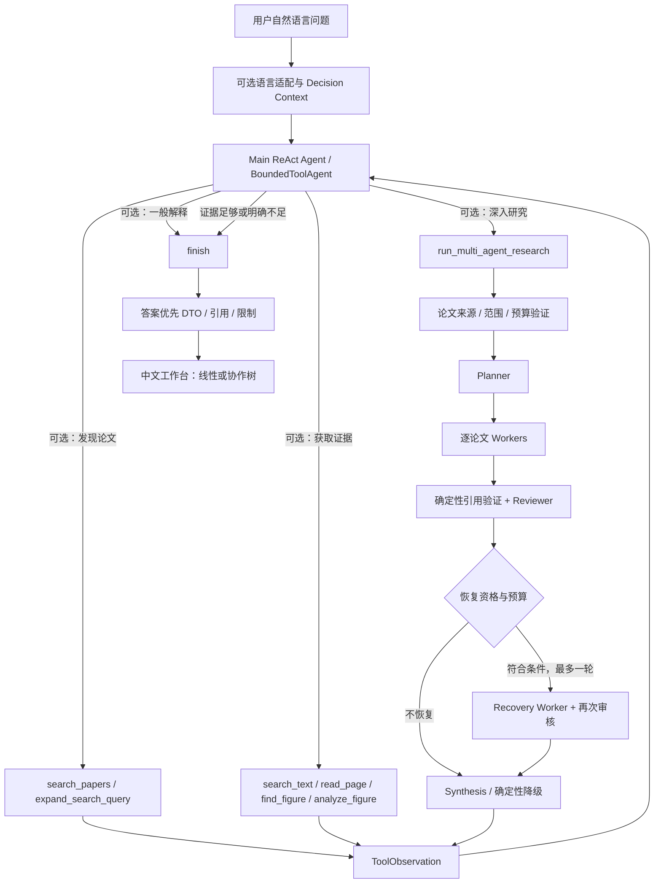
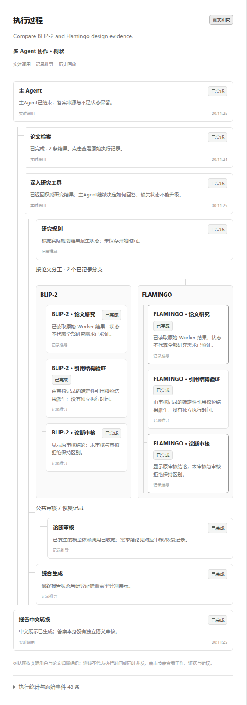

# 多模态论文研究 Agent · Multimodal Research Agent

**从自然语言问题出发，按需检索论文、补充证据或启动多 Agent 研究，并在中文工作台中展示真实执行过程。**

主 Agent 使用 ReAct 式工具决策循环：模型选择动作，程序验证动作与预算，工具返回观察，模型再决定继续调查或结束。多 Agent 是可选研究工具，不是每道问题都要执行的固定流程。

这是面向**本地受控论文语料**的研究与问答工程原型。项目提供证据身份约束、审核机制和有界执行，不宣称通用自主科研或完整人工事实验证。

[快速启动](docs/guides/quickstart.md) · [演示指南](docs/demos/demo-guide.md) · [系统架构](docs/architecture/system-overview.md) · [技术报告](docs/reports/technical-report.md) · [简历与面试介绍](docs/portfolio/project-summary.md)

## 核心特点

| 能力 | 当前实现 |
|---|---|
| 自主选择执行路径 | 直接回答、论文发现、证据检索或可选多 Agent 研究，由模型依据问题与 Observation 决定 |
| 分层论文检索 | 独立 Paper Index 发现候选，再用论文范围约束检索 Prepared Evidence |
| 有界查询扩展 | 模型按需生成最多 2 条查询；生成与检索分离，每请求最多扩展一次 |
| 按需多 Agent 协作 | Planner → 逐论文 Worker → 引用验证 / Reviewer → 可选一次 Recovery → Synthesis |
| 可追溯答案 | 引用映射至 Evidence ID、论文、PDF 页码和图号；保留审核、缺失和执行失败状态 |
| 中文动态工作台 | 答案优先；单 Agent 线性轨迹、多 Agent 协作树、节点详情、取消及只读历史回放 |

## 系统架构



模型负责语义决策；Controller 负责单动作协议、参数、论文身份、来源、预算和引用白名单。不会按关键词自动选论文，也不会截取多个动作中的第一个。

主决策最多 7 次，领域工具最多 6 次；协议纠正与正常决策共用上限，默认最多 2 次纠正。整个请求共享最多 200 次模型调用和 64 次实际工具执行预算，子研究还有各自局部限制。预算是失败控制，不是任务一定成功的保证。

详情见[主 Agent 编排](docs/architecture/react-workbench.md)、[研究链与引用机制](docs/architecture/system-overview.md)、[工作台事件契约](docs/architecture/workbench.md)。

## 主要功能与数据

- **论文发现**：25 篇本地论文元数据；检索表示可包含从标题、摘要抽取的离线画像。画像不是正文证据。
- **Prepared Corpus**：CLIP、BLIP、Flamingo、BLIP-2、LLaVA，共 46 条 TextEvidence、5 条 FigureEvidence。固定 PDF 版本、人工区域和图裁剪，不是任意 PDF 自动解析。
- **证据工具**：文本检索前按 `paper_ids` 限定范围；图定位使用论文与图号；未准备页和没有正文的候选明确返回不足。
- **图像能力**：已有 `analyze_figure` 可以将图片、图注与上下文交给配置好的 VLM；当前研究演示主要验证文本和图注，图像显示或文本分析不能证明像素推理发生。
- **研究结果**：只有通过引用校验和 Reviewer 的论断进入综合事实；拒绝和缺失不由模型知识补全。直接检索回答没有自动经过 Reviewer，主 Agent 新生成的比较措辞也不自动继承子报告的审核结论。
- **实验功能**：F3.1 Coverage Worker 保留为显式实验入口，默认研究链使用原 Worker。

## 技术栈

Python ≥3.11、Pydantic、FastAPI / Uvicorn、原生 HTML / CSS / JavaScript、PyTorch / Transformers、Qwen Embedding、Chroma、OpenAI-compatible Provider Adapter、pytest、Ruff，以及可选 Playwright 浏览器检查。版本约束以 [pyproject.toml](pyproject.toml) 为准；没有引入 LangChain / LangGraph。

## 快速开始

从源码仓库根目录运行，Linux / WSL 均可；配置与资源要求见[完整指南](docs/guides/quickstart.md)。

```bash
python3 -m venv .venv
source .venv/bin/activate
python -m pip install -e '.[test,retrieval,vision,llm,data,api]'
test -e .env || cp .env.example .env
python -m scripts.launch --check
python -m scripts.launch
```

打开 `http://127.0.0.1:8000`。未填写 Provider 或未准备索引时，可以查看已提交的 G2 / G2.1 历史回放；真实研究另需 Provider、固定 Embedding 缓存和匹配的本地索引。启动不会自动下载模型、重建索引或执行研究。

默认接口 `POST /api/research/runs` 只要求 `question`；不需要用户手动选择论文：

```bash
curl -X POST http://127.0.0.1:8000/api/research/runs \
  -H 'Content-Type: application/json' \
  -d '{"question":"What training objective does CLIP use to align images and text?"}'
```

## 演示案例

| 案例 | 验证来源与边界 |
|---|---|
| CLIP 训练目标 | 已保存真实主 Agent 运行：`search_text → finish`，15.39 秒，3 次模型调用（含中文展示） |
| BLIP-2 / Flamingo 连接机制 | 已保存真实主 Agent 运行：多动作拒绝 → 模型纠正 → 两次 scoped search → finish，28.95 秒；未启动多 Agent |
| 复杂逐论文研究 | Scripted 主策略已验证完整协作工具链与浏览器；已有 G2/G2.1 是真实默认研究链的历史回放。尚无可核验的真实 ReAct 主 Agent 自主协作运行产物，留作用户手动验收，不伪造日志 |

演示问题、记录与操作见[案例清单](docs/demos/demo-cases.md)。协作树预览来自 **Scripted 模型的工程验证**：



## 测试与验证

G4.3 已重新执行完整 pytest：1265 项通过（其中 12 项为本地未跟踪诊断测试）。干净源码副本的离线子集为 1251 通过、1 项索引资源检查跳过、1 项历史索引验收显式排除；完整、静态、启动和浏览器结果见[本轮验收](docs/releases/final-acceptance-report.md)，不复用历史通过数。

```bash
python -m pytest -q
ruff check app tests scripts eval
ruff format --check app tests scripts eval
python -m scripts.verify_release
```

原 Stage E 清单保留；经用户明确授权仅更新根 README，原 SHA 从 `stage-e-freeze-v1` 核验，其余 291 个冻结文件保持不变。原冻结校验仍会如实报告这一项差异，发布专用校验不放宽算法或数据哈希。

完整回归包含本地历史 Paper Index / 画像绑定检查；没有该资源的干净 checkout 可运行指南中的离线子集，不能把子集通过称为完整验收。本地未跟踪诊断测试也不混入发布仓库的测试数量。

历史 F2 的 90 条评测中，79 条满足 AI 辅助参考评分口径；它不是独立人工准确率。F3.1-E 的 7 条已知失败样本仅用于诊断，不能外推泛化收益。工程测试、引用身份有效、模型审核与独立人工事实核验分别记录。详见[实验汇总](docs/reports/experiment-summary.md)。

## 能力边界

1. 发现依赖本地索引，没有实时外部论文搜索、自动下载或任意 PDF 图表提取。
2. 25 篇元数据不等于 25 篇可研究正文；当前只准备 5 篇的受控片段。
3. VLM 需要真正支持图片输入的独立配置；DeepSeek 文本 API 不自动具备该能力。
4. 单 Agent 证据回答、Reviewer 审核事实、综合报告与主 Agent 新措辞的保障层级不同。
5. 引用白名单与结构校验不能完全检测自然语言幻觉、语义遗漏和范围漂移。
6. 模型路由与停止并非最优；有界纠正、重试和 Recovery 都可能耗尽或失败。
7. 任务和事件保存在单进程内；服务重启会丢失本次内存历史。取消在途同步调用需要等待实际收尾。
8. 历史回放不是本次实时研究，Scripted 通过不能推导真实性能提升。
9. 按源码 checkout 使用；本地索引、模型和画像缓存不随 Git 分发。冻结包元数据仍为 0.1.0，工程发布版本由 `v1.0.0` Git 标签标识，未改写冻结 `pyproject.toml`。

## 项目目录

```text
app/
├── agent/              # 冻结单 Agent 循环与约束
├── research/           # 主编排、研究链、预算、运行管理和公开结果
├── papers/             # 论文发现、画像与查询扩展
├── evidence/           # Corpus、Evidence、Resolver 与引用
├── retrieval/          # Embedding / Chroma / 范围检索
├── vision/             # FigureAnalyzer 与 VLM
├── tools/              # Tool Contract、Executor 和 Observation
├── api/                # HTTP 接口
└── workbench_web/      # 中文工作台与动态协作树
scripts/                # 准备、校验、运行与浏览器检查入口
eval/                   # 冻结评测、研究质量评分和实验入口
data/                   # 论文 fixture、Prepared Evidence 和候选数据
tests/                  # 工程与契约回归
docs/                   # 架构、指南、演示、实验与发布证据
configs/                # 当前研究配置
```

## 后续方向

自动科学 PDF 解析、跨模态检索、更大且独立人工审核的研究评测，以及持久化执行 / 图式运行时。它们是未来方向，当前没有实现新的研究闭环或 LangGraph 架构。

正式发布信息见 [v1.0.0 说明](docs/releases/v1.0.0-release-notes.md)。
