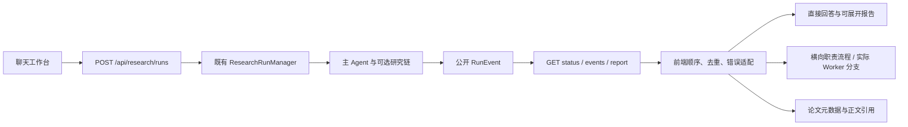

# 前端优化：实施前审计与最小接入方案

审计日期：2026-10-26。初始分支 `feature/h2-2-research-persistence`，HEAD `8ec79f613dcb2b688c6a0550ee904694bf60c1f2`。已跟踪文件和暂存区干净，保留 13 个既有未跟踪文件。完整基线位于本机 `artifacts/chat-workbench-2026-10-26/baseline.json`。

## 实际架构

- 界面为 `app/workbench_web/index.html / app.js / style.css`，由 `app/workbench.py` 的 FastAPI 同源提供，没有 React、前端构建服务、代理或跨域接入要求。
- 启动入口为 `python -m scripts.launch`，支持 `--check / --host / --port`。本轮使用回环地址 `127.0.0.1:8008`，不替换已有服务。
- 主 Agent 位于 `app/agent/loop.py`；工作台的研究接入位于 `app/research/react_runtime.py`。本轮不改变这些生产逻辑。
- API 位于 `app/api/research_runs.py`。研究由服务端 Manager 调度；前端每秒 GET 增量事件，未实现 SSE/WebSocket。
- 业务持久化由现有 `app/persistence/` 提供；禁用时任务只在进程内。本轮界面不能把连接健康检查宣称为完整 Schema 验收。

## 现有接口与边界

| 接口 | 用途 | 本轮处理 |
|---|---|---|
| GET `/api/research/papers` | Prepared 列表与本地 Catalog | 只读论文库，区分元数据与正文可用 |
| GET `/api/research/health` | 研究资源预检 | 运行配置页；不暴露密钥 |
| POST `/api/research/runs` | 主 Agent 创建/同键只读核对 | 使用既有 Idempotency-Key 与 Replay-Only 头；不新增 DTO |
| GET `/api/research/runs/{id}` | 状态 | 刷新/任务链接只读取 |
| GET `/api/research/runs/{id}/events?after=n` | 有序公开事件 | 连续游标、去重、缺口与截断提示 |
| GET `/api/research/runs/{id}/report` | 当前报告 | 使用真实直接回答、引用、限制；报告版本头保留 |
| POST `/api/research/runs/{id}/cancel` | 取消请求 | 只请求后端取消，不伪造节点终态 |
| GET `/api/research/replays` / POST `/replays/{id}` | 已有归档回放 | 明确不执行新研究 |
| GET `/api/storage/health` | 连接检查 | 单独显示存储状态 |

没有历史任务列表 API。左侧“最近记录”只能是本浏览器书签；归档回放另行标识。没有作者/URL 的目录记录不通过题名猜测补齐。

## 事件映射与最小修改

`node_id` 为节点身份、`event_id` 为顺序。MainAgent / PaperSearch / QueryExpansion / Evidence 对应实际工具过程；ResearchTool / Planner / Worker / Reviewer / Recovery / Synthesis 决定是否进入协作布局。Worker 只按已有 `paper_id` 或可信需求映射形成论文分支；没有 Worker 记录的审核不会制造 Worker 分支。派生校验记录继续标记 derived，没有独立生命周期时不推定开始/结束时间。

修改仅涉及新工作台静态文件、前端适配器、相关测试/验收脚本和文档。保留旧 `app/web/`、ReAct、研究链、API、数据库 Schema 和迁移文件。

## 本轮运行基线

原入口能启动，Provider/语料/索引预检 ready。WSL Playwright 所需 Chromium 缺失，下载因连接中断失败；实际浏览器验收改用本机已有 Windows Chromium。使用的是运行中应用，不把静态截图当成研究验收。

用户另行授权复用 Windows PostgreSQL 18 的 localhost:5432，新建独立 `personal_agent_ui_dev`，不连接 `agent_learning` 或生产库。新账号仅拥有新库、不具备 SUPERUSER/CREATEDB/CREATEROLE；认证配置只增加用户明确批准的单一 WSL 地址、新库与新账号 SCRAM 规则。既有迁移 `h2_0001` 用于空的新库，迁移源码未修改。完整真实结果见本轮验收报告。
