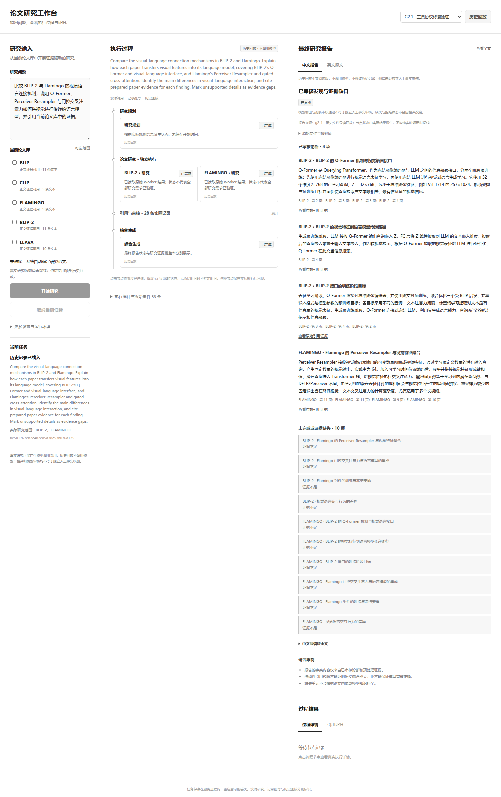

# Stage G4.2：极简中文动态研究工作台验收

**日期：2026-10-10。结论：PASS（本地工程、界面与适配契约验收）。** 本轮没有新的真实 Provider 研究质量实验，模拟集成不作为模型研究效果证明。

## 1. 基线与实施范围

按本轮新计划，从 G4.1 最终提交 `9e56ac22ca541c2dde0d2d8b656febc9b0d729f9` 创建 `feature/stage-g4-2-chinese-dynamic-ui`。开始时的作品集发布分支 `release/stage-g4-2-final-delivery`、提交 `72c07a752703178fdc48e9dceaa5dc530fc9cbc6` 和标签 `v0.1.0-research-agent` 保留；没有覆盖旧标签或历史发布材料。本轮仅本地 Git，不进行 push/pull，不创建新版本标签。

审计确认：原 Planner 动态生成维度，但要求先提供论文；原工作台要求手选2–3篇且预画等待节点。因此适配位于非冻结工作台层。原 Planner、Worker、Reviewer、Recovery、Synthesis、引用验证、Profile、Prepared Corpus、Embedding、检索排序和评测标签未修改。Coverage Worker 未默认启用。

起点记录见 [baseline.json](baseline.json)，审计事实见 [engineering_audit.json](engineering_audit.json)。原13个未跟踪诊断文件保留，不纳入本轮提交。

## 2. 完成内容与模块

| 内容 | 实现与边界 |
| --- | --- |
| 自动论文选择 | [paper_selection.py](../../../app/research/paper_selection.py)：仅从真实Prepared元数据通过一次结构化模型决策选2–3篇；校验身份、唯一性与依据，无匹配明确结束，不固定回退组合。 |
| 请求兼容 | [run_manager.py](../../../app/research/run_manager.py)：`paper_ids=[]`或省略进入自动模式；手选仍2–3篇，单选明确422；新增`language_mode=auto/original`。 |
| 中文问题 | [query_language.py](../../../app/research/query_language.py)：中文/含汉字混合默认适配，英文直通；保护原文、拉丁术语与阿拉伯数字，失败不提交错误英文问题。 |
| 中文报告 | [report_language.py](../../../app/research/report_language.py)：仅可读字段翻译，严格字段集合、类型、身份标记和数字检查；原证据、审核、缺口和引用不变，失败回退原文。 |
| 共享执行 | [workbench_runtime.py](../../../app/research/workbench_runtime.py)：三种适配共享物理请求预算、原Gate/异步边界；每项最多一次物理调用，原研究依赖重试策略不变。 |
| 可用性 | [workbench_dependencies.py](../../../app/research/workbench_dependencies.py)、[research_runs.py](../../../app/api/research_runs.py)：真实研究与语言配置就绪分开；`papers`仍为5篇Prepared，`catalog`区分25篇目录元数据的可研究状态。 |
| 动态事件 | [run_events.py](../../../app/research/run_events.py)：添加输入转换、论文选择、报告转换角色，保留原事件源及游标；翻译开始时权威原报告已可读。 |
| 极简界面 | [index.html](../../../app/workbench_web/index.html)、[app.js](../../../app/workbench_web/app.js)、[style.css](../../../app/workbench_web/style.css)：黑白灰三栏，无预置Agent，环境/统计折叠，报告常显，中文与英文可切换。 |

正文语料仍为5篇、46条Text Evidence、5条Figure Evidence；没有扩充论文或正文索引。自动选择是元数据相关性决策，不等于已得到研究证据。单选不能通过当前多论文协议，界面明确说明，避免偷偷扩大范围。

报告通过白名单将已验证译文合并到最终权威DTO的深拷贝；除允许的可读字段与确定性Markdown外，两份DTO一致，包括最终模型/工具调用统计。`source_sha256`绑定实际翻译输入，`final_source_sha256`绑定补齐最终调用账本的原文DTO。翻译语义本身没有独立审核。

## 3. 失败、取消与预算验证

输入转换失败停止研究并保留原问题，自动选择空结果不启动Planner。非法选择不能绕过真实Prepared身份校验；Provider缺失不自动换模型。

原研究已经产生报告后，翻译失败或预算耗尽不改变原研究状态。转换开始时原报告立即可查看；取消会保留报告并记录转换失败事件，任务取消语义保留。总体超时若发生在报告转换期间，原已完成研究仍保留完成状态并明确转换超时；研究阶段真正超时继续作为执行失败。同步调用始终等待实际drain，不宣称线程能被强杀。

输入转换、论文选择、报告转换各最多1次物理请求，计入同一个最多200次总账本。没有新增重试循环或Provider调用预算。原研究工具预算和局部协议纠正不变。现有客户端没有token/价格记录，新增适配记录调用数和耗时，不编造货币成本。

## 4. 动态节点与历史中文回放

初始页面零勾选、零Agent节点。事件按`event_id`排序去重，后端真实记录决定节点及Worker数量；迟到进展不降低终态或覆盖完成需求。Validator/Reviewer相邻记录收纳到可展开的“引用与审核”组，原节点ID保留，该组不是新增Agent。无执行或仅skipped的Recovery不显示为执行节点，原跳过事件继续可查。

`live`、`derived`、`replay`分别标记；派生校验不造生命周期时间。所有报告和事件通过安全DOM文本显示，不执行模型输出HTML，不公开密钥、内部消息、隐藏推理或堆栈。

G2/G2.1使用独立 [离线中文映射](../../../data/workbench_translations/g2-1.json)，绑定完整原DTO指纹，无Provider副作用。保留G2的5论断/7缺失、G2.1的4论断/10缺失，以及原失败和比较不足。中文翻译不把这些结果改写为成功。

实际最终页面截图：

截图是实际浏览器中的历史回放中文展示；不是新真实研究，也不是独立人审结果。来源与SHA见 [screenshot_sources.json](screenshot_sources.json)。Fake流水线截图在同一清单单独标注。

## 5. 本轮实际检查

| 检查 | 结果 |
| --- | --- |
| 最终完整pytest | **1220 passed，0 failed**，pytest计时40.15秒，外层实测40.83秒；新增65项，旧测试文件未修改。 |
| 新语言适配测试 | 43项：结构、术语/数字、错误回退、原对象与ID保护、历史来源绑定。 |
| 新后端集成测试 | 22项：自动选择、中文全链、无匹配、预算、单次请求、翻译可读/失败/取消/超时及全DTO白名单差异。 |
| Ruff | PASS，退出码0。 |
| Formatter | PASS，256个Python文件格式符合，退出码0。 |
| 真实浏览器 | 10组检查PASS，页面异常0；包含动态节点、中文/英文、失败详情、乱序重复、刷新、引用、390px、HTML防注入。 |
| 统一启动预检与实际服务 | `scripts.launch --check`与实际`--port`启动通过；页面200，语言就绪可解释，正常SIGINT退出0，没有研究POST或模型初始化请求。 |
| 冻结与历史 | Stage E292、原13未跟踪、40历史产物及9生产索引文件保持原指纹；原受保护CLI47项通过。 |

完整测试包含原有12项未跟踪诊断测试；它们按要求保留但不提交。最终Git源码包含原1143项与新增65项，共1208项，不把本机1220项误称为已全部发布的测试。

原始日志与命令见 [test_check.json](test_check.json)、[test_results.txt](test_results.txt)、[static_check.json](static_check.json)、[lint_results.txt](lint_results.txt)、[launch_verification.json](launch_verification.json)。既有Starlette/httpx弃用警告1条，不导致失败，本阶段没有改依赖。

## 6. 验证类型及实际成本

| 验证 | 真实发生的内容 | 可证明的范围 |
| --- | --- | --- |
| 实际服务启动 | 本轮通过真实统一CLI启动独立本机服务，GET页面/健康/案例目录后正常关闭 | 服务与配置检查可运行，不证明Provider连通或研究质量。 |
| Fake Provider领域集成 | 零勾选中文请求实际执行原Planner、两个默认Worker、Reviewer、Synthesis；模拟初始拒绝时触发原一轮Recovery | 工程契约、预算与恢复，不作为真实模型性能。 |
| 历史回放 | 本轮读取原G2/G2.1真实保存产物，加载中文离线副本 | 原始结果与展示一致，不是本轮重新研究。 |
| UI验证 | Playwright实际交互与截图，受控打乱/重复事件及失败响应 | 前端恢复、布局和错误回退，不是研究语义评测。 |

浏览器中带恢复的Fake例：17次模拟物理模型调用、4次Fake工具调用、2条模拟已审核事实；模型/工具选择来自测试夹具，不能作为技术事实正确率。无恢复的中文自动模式测试为11次模拟调用。**本轮真实Provider调用0、真实Embedding调用0、生产索引重建0、正式评测运行0。**

详见 [browser_check.json](browser_check.json)，不把其中模拟覆盖率1.0作为真实研究效果。单次真实Provider行为与转换语义质量仍待后续授权验证。

## 7. 交付、限制与阶段停止

使用指南已更新：[ui-quickstart.md](../../guides/ui-quickstart.md)。动态事件、自动选择与语言约束见 [chinese-dynamic-workbench.md](../../architecture/chinese-dynamic-workbench.md)。新浏览器检查入口为 `python -m scripts.check_chinese_workbench_ui`；旧脚本保留G4.1布局规则，不覆盖旧证据。

结构检查不等于翻译语义蕴含证明；中文展示与模型审核不能代替独立人审。自动选择受5篇Prepared范围限制。工作台仍是单进程内存任务，重启会丢当前任务，取消等待drain，启动不自动加载模型、重建索引或提交研究。

代码按选择适配、语言适配、后端集成、极简前端、测试文档验收拆分本地提交；最终SHA与工作区状态以Git及D盘交付清单记录，避免报告自引用。完成后停止，不推送、不打新Tag、不进入G4.3。
