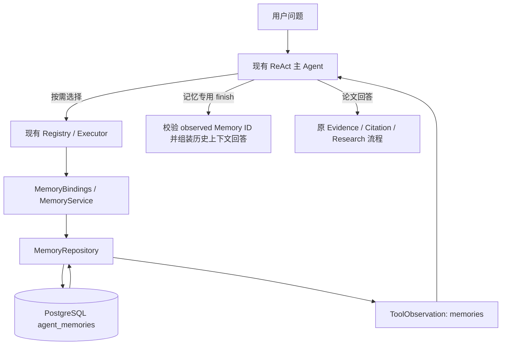

# P2：项目级持久化记忆

本模块保存跨任务可复用的用户偏好、项目决策及历史背景，默认关闭。它不复用研究报告或事件表充当记忆，也不读取全部聊天自动生成记忆。

## 1. 接入与边界



- 不修改 `BoundedToolAgent`、`MAIN_POLICY`、Retriever 或多 Agent 启用策略。四个工具通过原执行器、预算和观察反馈路径运行；同步工具沿用 `AsyncDecisionBridge` 等待异步数据库操作。
- 宿主按 `AGENT_MEMORY_PROJECT_ID` 绑定项目范围，工具不接受模型自选的 scope。没有用户身份系统，不提供多用户授权、行级安全或跨项目共享。
- 记忆是用户声明的项目历史上下文，不是论文 Evidence。返回字段为 `memories`，Memory ID 不进入 Evidence/Citation 白名单。现有 Trace 的 evidence `result_count` 仍为 0，观察中另有 `memory_count`。
- P1 外部工具适配层与本模块独立。没有 Redis、Embedding、向量记忆、Memory Agent、新线程池或自动记忆提取调用。

主要文件：

| 文件 | 职责 |
|---|---|
| [models.py](../../app/memory/models.py) | 严格参数、领域对象及完整性校验 |
| [config.py](../../app/memory/config.py) | 显式启用、项目身份配置 |
| [policies.py](../../app/memory/policies.py) | 当前用户原文来源绑定与敏感内容拒绝 |
| [service.py](../../app/memory/service.py) | 范围、来源、有效期及业务规则 |
| [retrieval.py](../../app/memory/retrieval.py) | 字面匹配、排序常量和确定性参考逻辑 |
| [tools.py](../../app/memory/tools.py) | 四工具、观察、写入故障与本次已观察记录 |
| [integration.py](../../app/memory/integration.py) | 可选消息、finish 与答案展示适配 |
| [memory_repository.py](../../app/persistence/memory_repository.py) | 异步短事务、并发和存取 |
| [memory_models.py](../../app/persistence/memory_models.py) | 独立 ORM metadata，单表结构 |
| [p2_0001_agent_memory.py](../../migrations/versions/p2_0001_agent_memory.py) | 新增迁移，不修改 H2 历史 |
| [react_runtime.py](../../app/research/react_runtime.py) | 可选工具和答案适配装配点 |
| [workbench.py](../../app/workbench.py) | 原应用生命周期内的启用与 schema 检查 |

## 2. 数据、来源与生命周期

类型只有 `preference/project_decision/project_fact/workflow_lesson/research_context`。所有类型均为用户声明，类型名称本身不证明事实正确。

记录包括 Memory ID、scope、类型、逻辑键、正文、tags、来源引用/原文、状态、版本、内容 SHA256、创建/更新时间、可选到期时间、替代关系及删除来源。

- `memory_key` 是稳定逻辑键（最长 80 字符，小写 ASCII 字母开头，可用数字与 `_.:-`），不能每次换键绕过去重。
- 正文最长 2000 字符，tags 最多 8 个、单个最长 32 字符，规范化、去重后保存。
- 首版仅允许正文为**本次原始用户问题的完整原文片段**；不接受模型摘要、猜测、任意文件路径或从外部工具复制的内容。来源由服务生成 `question_sha256:...` 与对应摘录，不提供用户自填 source_ref。
- 用户必须重新明确表达更新内容；删除 reason 同样须为本次问题原文片段。原文约束更保守，不能自动将已完成研究总结成长期记忆。
- 相同项目、键、正文及类型的 active 记录，save 返回 `unchanged`；tags/TTL 的变化需显式 update。相同键内容不同返回 `memory_conflict`。
- update 使用已观察 ID、expected_version 和同一逻辑键。新版本新 ID，旧版本 `superseded`，正文不覆盖；替代与新增同事务。
- forget 是软删除，保留正文与删除来源用于审计，不是隐私物理擦除。重复删除同一已删除版本是幂等的。
- 正常查询只返回 active 且未过期记录。过期过滤不依赖后台任务；新来源可以建立后继版本。旧创建请求不能复活已删除版本或重置已到期 TTL。

并发使用数据库短事务内、最多等待 1 秒的 scope/key advisory lock 及行锁；这是记忆写入协调，不是 Agent 分布式调度锁。部分唯一索引保证同逻辑键最多一个 active 版本；复合自关联约束限制跨 scope 替代。版本检查失败不会自动重试。

## 3. 工具契约

所有模型均拒绝未知参数，严格检查类型。四个工具是内部工具；它们仍消耗原模型/工具预算，不强制每次请求调用。

| 工具 | 参数 | 结果 |
|---|---|---|
| `memory_search` | keywords、tags、memory_types，可选 top_k=5（1–10） | 有限 active 记录、来源与版本；无匹配为 empty |
| `memory_save` | memory_type、memory_key、content；可选 tags、expires_at | created / unchanged 或明确冲突 |
| `memory_update` | save 参数，加 memory_id、expected_version | superseded / unchanged；须先观察目标 |
| `memory_forget` | memory_id、expected_version、reason | deleted / unchanged；须先观察目标 |

`expires_at` 必须带时区且晚于当前时间。search 至少需要 keywords、tags、memory_types 中一项，不能无条件扫描整个项目。关键词与标签分别最多 8 个。

示例仅是**参数示例**，不是本次真实模型运行记录。用户问题含“请记住：先讲公式，再讲代码。”时，合法 save 如下：

```json
{
  "memory_type": "preference",
  "memory_key": "explanation.style",
  "content": "先讲公式，再讲代码。",
  "tags": ["讲解偏好"]
}
```

后续请求可以按需使用：

```json
{"keywords": ["公式"], "memory_types": ["preference"], "top_k": 5}
```

只有一次性普通问题时，可以沿原路径直接 finish，不必调用记忆。模型有记忆工具可用，不代表本阶段验证了真实模型会稳定作出最优调用决策。

## 4. 检索、观察与终止

关键词按小写字面子串匹配正文或逻辑键，`%/_/反斜线` 转义；不将用户输入拼成 SQL。一个关键词命中正文权重 2、键权重 3；一个匹配标签权重 2。关键词内 OR、标签内 OR，不同筛选类别同时满足，类型使用 IN。按分数降序、更新时间降序、ID 升序排序并限制 Top-K。纯类型筛选按时间、ID 排序。

这是有限的关键词检索：中文请用短词或明确标签，不声称具备语义召回、分词或跨语言理解。

观察沿用 success/empty/error envelope：

- 无匹配：`status=empty`，`issue.code=empty_result`，不是数据库故障。
- 数据库不可用：`status=error`，`issue.code=dependency_failure`，另带 `memory_unavailable`；不转换为空。
- 提交确认不明：`memory_commit_unknown`、`retry_mode=reconcile_only`。当前请求同键后续写入被锁止，只允许读核对；读到记录也不自动将未知提交“确认成功”。
- 配置、schema、锁等待、参数、版本冲突、源无效等保留各自 `memory_error_code`。没有无界自动写入重试。
- 未解决写入故障使最终运行 failed，并明确写入尚未可靠完成，不能用模型的成功措辞掩盖故障。取消沿原链路传播，不伪装为空结果。

可选 `answer_kind=memory` 与 `memory_ids` 仅适用于记忆回答/操作确认。程序校验这些 ID 是本次已观察、仍有效或本次已删除的记录；答案从权威记录确定性组装，不采用模型自由改写的记忆事实。记忆引用在 `source_references` 中独立标记 `project_memory`，原论文五种答案与引用校验保持不变。

记忆是观察时快照：同一请求中别的进程更新后的即时一致性不作承诺。程序会检查时间过期，删除/更新本次已观察版本后相应失效；多实例实时失效通知不属于本阶段。

## 5. 安全与生命周期

- 明显密钥、密码、连接串、私钥及常见敏感个人信息按规则拒绝，不能声称规则检测可覆盖所有敏感表达。
- 记忆工具参数的 content/reason/检索词/tags 在执行事件和 ToolTrace 中省略并保留摘要；ID、键等有限字段保留。**这不是整个应用的统一隐私清除**：原研究请求本身的存储与留存规则没有改变。
- 数据库异常仅返回固定错误码和安全文字，不输出 SQL、密码或完整 DSN。
- 默认禁用不导入 SQLAlchemy/asyncpg，不影响回放。启用使用现有 DatabaseResource/session 工厂，应用生命周期退出负责清理；不创建第二套引擎。
- 自定义 manager_factory 的测试/宿主仍自行负责其依赖装配，默认装配不擅自改变自定义管理器。

## 6. 安装与启用

基础启动见 [quickstart](../guides/quickstart.md)，数据库安全与账户隔离见 [persistence](../guides/persistence.md)。本阶段没有新增第三方依赖，没有改冻结的 pyproject、锁文件或 .env.example。

现有带哈希安装入口：

```bash
python -m pip install --require-hashes -r requirements-runtime.lock -r requirements-persistence.lock -r requirements-h2-test.lock
python -m pip install --no-deps -e .
```

迁移工具声明在 `requirements-migrations.txt`（Alembic >=1.20,<1.21）。仓库尚无带哈希的 migrations.lock；本次复用了现有 Alembic 1.20.0 环境，**未重新完成干净环境依赖安装**。不要把本次测试当作新环境全部依赖可复现安装的证明。

默认 `AGENT_MEMORY_ENABLED=false`。准备启用时，维护者应先向**单独授权的目标库**执行迁移；此处仅展示命令，不授权对已有库执行：

```bash
python -m alembic upgrade p2_0001
```

迁移只读取安全注入的 `H2_MIGRATION_DATABASE_URL`，不回退应用 URL。应用启动不执行迁移或建表。请通过本机秘密配置机制注入，不把密码写进命令历史。

运行配置：

```text
H2_DATABASE_ENABLED=true
H2_DATABASE_URL=<通过本机秘密配置注入，勿提交>
AGENT_MEMORY_ENABLED=true
AGENT_MEMORY_PROJECT_ID=<维护者指定的稳定项目ID>
```

以上尖括号是说明占位符，不能直接作为有效环境值。配置代码读取进程环境，不自行加载任意 .env。缺少项目、数据库配置或 p2_0001 schema 时，启用应明确失败。已有启动命令仍为：

```bash
python -m scripts.launch
```

本轮**没有修改或迁移用户已有开发库**。正式启用前仍需另行确认目标、权限和备份；临时测试库的通过不授权迁移任何其他数据库。

## 7. 验证与限制

离线测试：

```bash
python -m pytest -q tests/unit/memory tests/test_agent_memory.py
ruff check .
ruff format --check app tests migrations
git diff --check
```

真实测试文件为 [test_memory_postgresql.py](../../tests/integration/test_memory_postgresql.py)。只有 `P2_TEST_MEMORY_AUTHORIZED=yes` 且私密 `P2_TEST_MEMORY_DATABASE_URL` 指向**精确的已授权目标**（127.0.0.1:55437、personal_agent_memory_test、p2_test、ssl=disable）才执行。缺门控时跳过；目标不同先拒绝连接。原 H2、arXiv 真实测试门控均保持关闭。本轮只在一次性 PostgreSQL 16 容器中验证，结束已销毁。

实际命令、72 项新增测试、全量离线回归、迁移和保护证据见 [P2 验收报告](../acceptance/p2/acceptance_report.md)。真库 + Scripted Policy 验证的是工程接线，不是真实模型自主记忆质量实验。没有新的浏览器交互验收、付费模型研究、生产部署或网络故障长期可靠性实验。

当前限制：

1. 单一宿主配置的 project scope，没有多用户身份和授权体系。
2. 只接受当前用户原文，不自动抽取工具结果或研究报告为记忆。
3. 不做语义冲突识别；不同逻辑键仍可能保存语义重复内容。
4. 来源是用户声明及问题 hash，无 run_id 外键、人工事实审核或证据等级提升。
5. 软删除保留审计正文；敏感规则与参数最小化不是全面隐私管理。
6. 关键词/标签检索不等于语义检索，可能漏掉改写表达。
7. 新迁移当前检查 p2_0001；后续迁移时需同步设计版本兼容策略。
8. 实际用户开发库尚未迁移、未启用；本轮通过不能替代该库的独立部署授权。

P2 完成后停止。后续可以准备少量 P1/P2 联合真实案例，但需要单独范围与 Provider/数据库授权，不自动启动。
