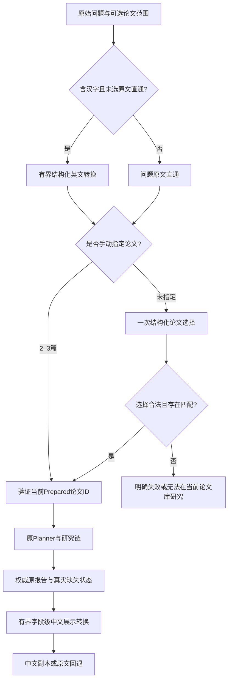

> 当前默认入口：ReAct 主 Agent。只输入问题，多论文研究是可选工具；原 Prepared-only 选择/手选界面为历史说明。[自主编排架构](react-workbench.md) / [使用指南](../guides/react-workbench.md)。

# 中文动态研究工作台：适配边界与事件规则

本轮从 G4.1 最终提交建立 `feature/stage-g4-2-chinese-dynamic-ui`。此前作品集发布分支和 `v0.1.0-research-agent` 标签保留，当前新增工作不推送、不覆盖标签。非冻结工作台层适配用户输入与展示，原 Planner、默认 Worker、Reviewer、Recovery、Synthesis、引用规则、Prepared Corpus 及检索排序保持不变。

## 输入与可研究范围

自动选择只接收当前有正文证据的 Prepared 论文元数据。25篇 Paper Catalog 不等于25篇可研究论文；本轮仍是5篇、46条文本证据、5条图像证据。选择结果及依据是过程记录，不是研究事实或已审核结论。没有相关论文不能自动替换成固定组合。

当前研究协议保留每任务2–3篇上限。单选明确提示，不偷偷扩大用户范围。中文与中英混合问题以是否含汉字为适配规则，英文默认直通；这一规则不宣称原 Embedding 无法处理中文。原文直通用于显式调试。

## 报告语言边界

原始结构化报告始终权威。中文仅转换白名单内的可读文本，模型不能提交新的 Claim、Citation、论文、页码、审核状态或技术结论。程序检查字段集合、文本类型和保护标识，再将翻译覆盖到原 DTO 的深拷贝上。

结构校验不能完全证明翻译语义等价。中文版不构成新 Reviewer 审核或独立人工事实核验，引用证据正文仍显示论文原文。转换失败、超时或预算不足时，原报告和真实研究状态继续可用。

历史 G2/G2.1 使用单独的离线中文翻译映射，绑定原报告展示 DTO 的 SHA256；原历史文件不修改。绑定失败回退原文，不自动请求模型。历史失败、证据不足、缺失状态和比较数不会因翻译变为成功。

## 动态节点与数据来源

页面初始不创建 Planner、Worker、Reviewer 或 Recovery 占位节点。使用事件接口及 `after` 游标增量取得记录，以 `event_id` 去重并按序更新；刷新恢复同一任务，不重新提交研究。

| 来源 | 可表示的事实 | 时间规则 |
| --- | --- | --- |
| `live` | 当前运行的模型、检索或适配调用活动 | 只显示服务端记录的时间，不由浏览器估算阶段时间。 |
| `derived` | 从完成记录推导的需求、审核、引用校验或阶段结果 | 没有原生命周期时保留空时间，不称作实时执行。 |
| `replay` | 已保存 G2/G2.1 历史执行记录 | 明确标历史回放；没有时间不补写。 |

一个事件不意味着整个角色已完成。Worker 数量按实际计划和身份记录出现；并行执行不假定完成顺序。Recovery 只有实际执行记录时显示，跳过条件可以在过程详情记录但不造出成功恢复节点。Validator 没有独立生命周期时只显示结构验证结果。

节点只呈公开的研究需求、工具参数范围、证据摘要、审核与错误。模型消息、隐藏推理、密钥、内部堆栈及本地路径不进入公开诊断。所有服务端文本使用安全 DOM 文本展示，不执行报告中的 HTML。

## 预算与失败

输入转换、自动选论文和报告转换各有单次调用边界，并计入与原研究链共享的物理模型请求账本。不会在检索或 UI 轮询时反复生成转换结果；启动、健康检查与历史回放均不发模型请求。

Provider 配置就绪与真正连通分开；健康检查只读。语言适配依赖单独说明，但真实研究仍需原语料、索引、缓存及服务配置。取消和超时继续等待已启动的同步调用收尾，不声称能够强杀 Python 线程。

输入转换失败不继续提交未经校验的问题；无匹配论文不伪造 Evidence；报告转换失败不覆盖原研究结果。研究失败也保留已有过程信息，仅权威报告中的审核通过 Claim 可以作为结果展示。

## 验证口径

Fake Provider 集成用于验证无勾选、中文输入、默认研究链、预算与错误传播；实际浏览器用于验证布局、动态事件、历史回放与引用查看。这些都不等于新的真实研究质量实验。本轮不重跑90题、不重建索引、不扩充语料、不启用 Coverage Worker。

使用命令见 [工作台指南](../guides/ui-quickstart.md)。最终实测数量与证据见 [本轮验收](../acceptance/stage_g4_2_chinese_dynamic_ui/acceptance_report.md)。
