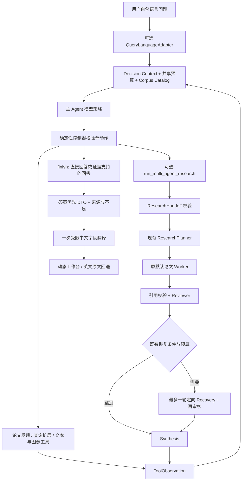

# ReAct 主 Agent 与中文研究工作台

本轮以自然语言问题作为默认入口。实际执行循环仍是 `BoundedToolAgent.run`，非冻结的 `MainResearchAgent` 只扩展终止契约，`MainPolicyClient` 提供主入口策略。多论文研究作为 `run_multi_agent_research` 注册工具，由模型在运行时决定是否调用。旧 `app.main` 单问题 API、Planner、默认 Worker、Reviewer、Recovery 和核心 Synthesis 保持原实现。

## 真实执行路径

没有一次性意图分类器，也没有依据关键词启动固定流程。一般概念可以直接回答；论文发现可以只返回元数据；工具获得足够证据后可以结束；需要深入研究时才升级为研究工具。单篇、多篇或比较问题均不会被程序强制进入研究链。

## 模型与程序的职责

模型解释用户意图、选择动作、决定证据是否足够、选择有来源的目标论文并编写直接回答。程序校验动作数量、工具参数、论文身份、显式范围、候选来源、引用白名单和预算。程序不会从 `CLIP` 等关键词静默添加检索范围，不会取候选前三篇代替模型选择，也不会改写非法参数后继续执行。

主 Agent 沿用原循环：最多 6 个领域工具动作，最多 7 次模型决策；最后一次决策只允许 finish。重复动作、查询扩展限制和非法 finish 的反馈行为沿用原控制器。冻结循环的严格单动作校验保持不变。非冻结 `MainPolicyClient` 收到零动作或多动作时，不执行任何动作，将结构化协议反馈加入请求副本，让模型重新选择。默认最多 2 次纠正，与正常决策共用最多 7 次主决策额度；物理请求扣减原共享预算，不消耗工具额度。纠正耗尽后原始违规响应交给冻结 Controller 安全终止。公开事件及 `protocol_trace` 保留拒绝和恢复，不记录模型正文或隐藏推理。

## 论文资源与只读一致性

本地 Catalog/Paper Index 各有 25 篇论文。Prepared Corpus 有 5 篇、46 条文本证据和 5 条 Figure Evidence。论文元数据发现不等于正文可用；没有外部实时论文搜索接口。

既有 Paper Index 使用增强画像，而原始 Catalog 未全部携带画像。`discovery_resources.load_index_catalog` 只读取原 fixture、24 篇已有画像缓存以及 SQLite 索引，验证 title/abstract 来源摘要、fixture SHA256、representation version、25 个身份及每条完整 PaperDocument 相等。缺画像论文使用原有空画像。校验失败不会削弱 `SearchPapersTool` 的相等约束；实际检索返回结构化失败。

启动不会加载模型或调用 Provider。首次真正执行检索时，`WorkbenchDependencies` 从固定本地缓存加载同一个 Qwen Embedding 实例，论文索引和证据索引共享实例。调用仍是原 `PaperRetriever` 的单查询 TopK，不改变排序，不重建索引，不在请求内抽取画像。

## 结构化研究交接

`ResearchToolInput` 要求研究目标、1–3 个合法论文 ID、选择来源与每篇简短选择理由。`ResearchHandoff` 由程序补齐：

- 用户原始问题、内部执行问题与本次研究目标。
- 实际选定论文及理由。
- 已执行检索查询、候选引用及每篇正文可用性。
- 原显式范围、禁止外部下载、默认 Worker 标志。
- 交接时共享预算快照。

`retrieved` 必须来自本次实际发现结果；`named` 只验证该 Catalog 名称是否出现在原始问题，验证不用于决定执行路径；`explicit_scope` 必须来自请求范围。缺正文目标保留原 ID，作为不足研究单元进入旧链，不能被替换成其他论文。

研究工具每次运行最多真正启动一次，不注册给子 Worker，不允许递归。返回 report_reference、源报告 SHA256、经旧链审核的 Claim 引用、实际缺失状态、执行摘要和预算。失败报告的部分已审核事实使用 `verified_claim_references` 保留，工具自身仍返回 error，不能伪装成成功检索证据。

## 共享预算、并发与取消

主决策、查询翻译、查询扩展、子 Planner/Worker/Reviewer/Recovery/Synthesis、VLM、最终中文转换均在物理请求开始前扣减同一线程安全账本。默认总请求上限 200（API 可降低），总工具执行上限 64；子链原有局部上限继续有效。研究启动前至少需要 `论文数 + 3` 个剩余请求额度，仅是最低启动条件，不保证研究成功。子链预留主 Agent 返回后的一次决策机会，不能获得新的独立额度。

同一 ResourceGate 用于主依赖与子研究，原有 Worker Pool、信号量和 RetryPolicy 保持不变。每个物理 Provider 重试都计数；模型决策次数与物理请求数分开记录。finish 不计领域工具执行，schema/范围拒绝及重复拦截不会访问 Retriever。子报告统计本次子链增量，总回答统计整个请求，不把两者相加重复计费。

工作台继续单进程任务队列：1 个运行任务、最多 2 个排队任务，进程内保留历史。420 秒是软超时；取消传播后会等待已进入同步 SDK/模型线程的实际操作收尾，不能宣称立即硬终止。取消或超时保留已保存的研究报告；答案后的语言转换失败保留直接回答与原文。

## 答案与证据边界

统一公开层包含 `answer_status / direct_answer / key_findings / citations / limitations / detailed_report / execution_mode / source_references`。

- `general`：无工具的一般解释，无论文引用，明确未经过论文或 Reviewer 核验。
- `metadata`：实际候选元数据，仅用于论文发现，不伪装成正文引用。
- `evidence`：引用必须是当前通过工具看到的真实 Evidence ID。
- `research`：Claim 必须来自已经返回到主模型上下文的研究报告，引用属于选定 Claim，并可解析回当前 Corpus。
- `insufficient`：有明确限制，无伪引用，不把失败包装成成功研究。

原始 Claim、引用、报告和缺失状态由程序保留；主模型的新措辞不会自动继承 Reviewer 的语义审核结论。ID/结构校验不能证明自然语言蕴含、意图对齐或“确实没有补充模型记忆”。这些约束由策略引导，稳定程度需要另做真实模型质量评测。

中文转换仅开放可读字段，包含直接回答与关键事实文字；ID、证据原文、审核/缺失状态不进入翻译权限。英文原文及详细报告始终保留。历史回放先验证原有中文副本，再增加答案首屏；不足历史只陈列已审核事实与缺口，不离线编造完整比较结论。

## 工作台与验证边界

左栏只输入问题、浏览论文可用性；中栏仅根据实际事件产生角色，没有预绘 Worker；右栏先显示答案、依据、引用与限制，再展开详细报告。沿用增量事件、游标去重、刷新恢复、取消和历史回放。字符串全部经 textContent 展示，不执行模型 HTML。

三种路径用 Scripted 策略贯穿真实领域组件验证，G2/G2.1 是已有真实研究链的离线回放。协议修复阶段另保存 CLIP 与 BLIP-2/Flamingo 两次真实主 Agent 运行；后一条真实出现 multiple_actions → feedback → single action，最终两次文本检索后 finish，并未启动研究工具。详见[协议验收](../acceptance/stage_g4_2_protocol_fix/acceptance_report.md)。尚无可核验的真实主 Agent 自主协作运行产物，见[Demo C 状态](../demos/demo-cases.md)。工程通过不等于语义已人工核验或研究正确率提高。

布局按真实事件自动切换：主 Agent / 普通工具保持线性；实际研究调用触发树状分工。只有已记录的角色出现，论文归属未知的审核保留公共节点；线条不推断时间或并发。见[协作树验收](../acceptance/workflow_tree/acceptance_report.md)。
