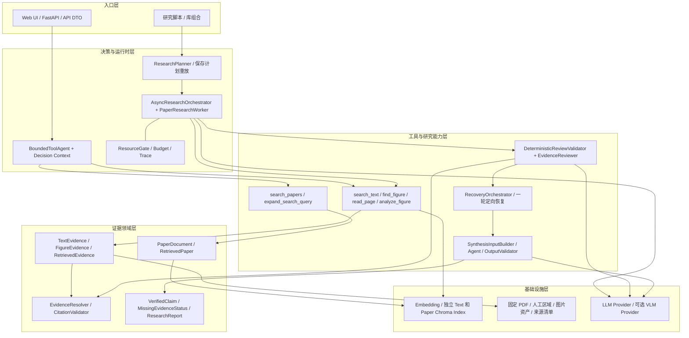
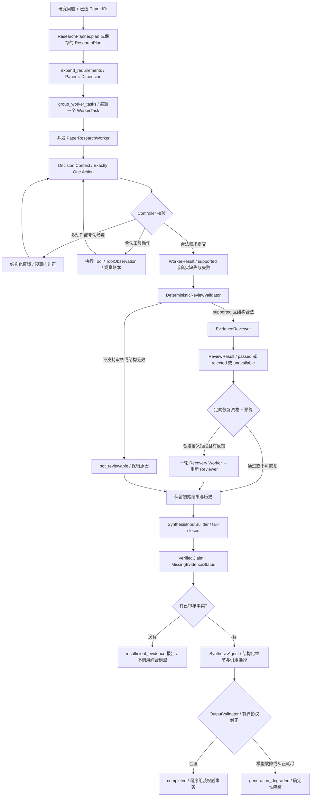

# 系统架构与能力边界

这是一套针对**已有预处理论文材料**的证据驱动研究原型。它把跨论文问题拆成各论文的独立研究需求，在有界执行后审核论断、定向恢复被拒需求，并组装保留缺失项的结构化比较报告。

本文以 2026-10-09 的源码为依据。源码索引见 [工程清单](engineering-inventory.md)，操作见 [开发指南](../guides/development.md)，本轮验证见 [G1 验收](../acceptance/stage_g1/acceptance_report.md)。

## 1. 两条入口与能力边界

**单 Agent 演示路径**：FastAPI / Web UI → `AgentAPIRuntime` → `BoundedToolAgent`。模型基于 Observation 决定搜索、读页、查图、可选分析图片或 finish。已有 API DTO 将领域结果投影为答案、引用、行为轨迹和指标；不直接序列化整个运行时对象。

**多论文研究路径**：研究库 / 独立脚本 → ResearchPlan → WorkerTask[] → 并发 Worker → Reviewer → 最多一轮 Recovery → Synthesis。该路径尚未接入现有 API/UI。`evaluate_cross_paper.run_case` 重放已保存的计划，不在每次运行时重新调用 Planner；`ResearchPlanner` 本身存在独立入口和测试。

论文元数据发现有 25 篇候选，Prepared Corpus 有 5 篇、46 条文本与 5 条图像证据。API 默认只加载 V0.1 的 3 篇、25 条文本、3 条图像；研究脚本显式合并追加语料。未准备的论文或页面返回不可用 / 空结果，系统不会临时下载全文或解析任意 PDF。

### 多模态能力的准确表述

| 能力 | 实现与验证边界 |
| --- | --- |
| Prepared PDF 文本与图注证据 | 当前研究主路径；固定版本、人工 region / crop、页码、来源哈希可追溯。 |
| Figure 定位与展示 | `find_figure` 按论文与 Figure ID 定位已准备图片；返回 opaque asset reference。没有 image-vector retrieval。 |
| 可选图片输入 | `analyze_figure` → FigureAnalyzer → Vision Client；适配器实际读取图片并发送 image_url，联合 Caption / Text Context。需要提供方真的支持图片。 |
| 当前研究质量评测 | 主要依据文本和图注；Reviewer 的 ReviewEvidence **不含图片像素**。Stage F3.1-E 正式七题 VLM 调用为 0，不能作为像素级视觉推理质量证据。 |

因此可以称为“围绕文本与 Figure Evidence 的研究工程原型”，不能把当前研究验收说成已经验证了像素级视觉推理、任意科学 PDF 自动理解或通用自主研究能力。历史单 Agent VLM Smoke 的验证条件见 [Demo 状态](../demos/README.md)，不得外推为当前跨论文 Benchmark。

## 2. 逻辑架构

图中表示职责关系；不是每个请求都会执行全部工具。Paper Discovery 属于独立能力，现有研究脚本接受已选论文集合，不自动将开放问题串成“发现 → 下载 → 多论文研究”。

## 3. 主要模块及接口

| 模块 | 职责 | 关键接口 / 模型 |
| --- | --- | --- |
| Planner | 从问题生成中性、互不重复的研究维度；校验候选论文身份。 | `ResearchPlanner.plan` → `ResearchPlan`；`prepare` → `ResearchPreparation`。 |
| 需求投影 | 稳定生成论文 × 维度需求，并按论文分组。 | `expand_requirements` → `EvidenceRequirement[]`；`group_worker_tasks` → `WorkerTask[]`。 |
| Worker | 只研究自身论文；每轮观察反馈后选择一个动作，收集引用并提交需求结果。 | `PaperResearchWorker.run` → `WorkerResult`。 |
| Retriever | query embedding → store → 范围过滤的 Top-K；不负责判断证据充分性。 | `TextRetriever.search_text` → `RetrievedEvidence[]`；`PaperRetriever.search` → `RetrievedPaper[]`。 |
| Citation Validator | 校验引用身份存在及白名单子集，Resolver 检查当前语料和模态。 | `CitationValidator`、`EvidenceResolver`。 |
| Reviewer | 先验证需求、观察账本、论断及引用绑定，再让模型审核引用是否支持论断。 | `ReviewTask` → `ReviewResult`；不代替需求完整性评估。 |
| Recovery | 只为精确绑定的审核拒绝需求再调查一次；保留历史，重新审核后合并。 | `RecoveryTask` / `RecoveryOutcome`。 |
| Synthesis | 只选用已审核事实组织报告；权威论断和引用由程序组装。 | `SynthesisInput` / `SynthesisProposal` / `ResearchReport`。 |

模型负责语义决策；Controller 负责确定性约束。Controller 不根据论文关键词偷偷选 scope，不选择多个 actions 中的第一个，也不因 search 成功就强制 finish。引用合法只能说明身份与结构合法，不能证明语义正确。

## 4. 端到端研究数据流

取消会保留 `cancelled` 并传播，不转成“证据不足”。图中反馈分支始终受模型调用预算限制，不构成无限循环。Worker 的 `supported` 是待审核论断，不是 `VerifiedClaim`。

## 5. 证据、引用与综合准入

来源链路为：固定 PDF / SHA256 → 人工选区与页码 → prepared text / Figure crop → Evidence ID → Worker 观察账本 → 引用 → Reviewer → VerifiedClaim。

- Evidence 页码是 **从 1 开始的 PDF 页序号**，不保证与印刷页码相同。
- 文本 ID 使用论文版本 ID、页码、模态、段落文本生成；Figure ID 使用相同身份维度与局部 Figure 标识。相同来源生成稳定 ID；文本变化会产生新的文本 ID。
- Corpus Loader 校验 PDF、页面和资产哈希；研究追加语料还要求完整 `source_manifest.json` 与 `prepared_evidence.jsonl` 来源链。
- Resolver 将 Evidence ID 解析到当前语料记录；模型看到 opaque asset reference，不接收任意本地路径。
- Worker 引用必须来自已观察证据且属于自身论文。Reviewer 只审核精确绑定的论断和引用，不审核未经检索观察的模型记忆。
- SynthesisInputBuilder 只接收 **supported + validation passed + 精确匹配的 review passed**。缺失、身份不匹配、冲突或重复审核结果采用 fail-closed；拒绝 Claim 正文不进入事实输入。
- 缺失单元保留 `insufficient_evidence`、`review_rejected`、`review_unavailable`、`execution_failed`、`cancelled`，不能被模型升级为 verified。
- 综合模型不改写权威 Claim。比较只能在同一维度并列各论文合法 VerifiedClaim；跨论文比较缺少任一方证据时不能制造完整结论。输出验证是结构与引用检查，不是自然语言蕴含证明。

## 6. 有界执行、失败与恢复

以下是 [ResearchRuntimeConfig](../../app/research/runtime.py) 默认值和 [Stage E 配置](../../configs/cross_paper_eval.json) 的现有设置，不承诺任务一定在预算内成功。

| 约束 | 当前值 / 行为 |
| --- | --- |
| Worker / LLM / VLM / Retrieval 并发槽 | 3 / 2 / 1 / 1，共享 ResourceGate；Worker 槽与依赖槽分开。 |
| 每个初始 Worker | 最多 20 次模型调用预算、8 次实际工具调用预算；最多 2 次协议纠正。 |
| 单次依赖等待 | 60 秒；默认最多 2 次 transient retry。排队等待及线程完成清理不等于整题总耗时。 |
| Reviewer | 每需求最多 3 次模型调用；Reviewer 并发 2。 |
| Recovery | 最多一轮；默认每恢复 Worker 模型 12 / 工具 4，配置研究总预算为模型 200 / 工具 64，保留综合预算。 |
| Synthesis | 模型预算 5，协议纠正最多 2；失败保留已审核事实并标记降级。 |

必须区分三种恢复：

1. **基础设施重试**：明确的 429 / 502 / 503、连接或 Provider 超时等 transient failure 有界重试；永久失败不重试。业务空结果不是基础设施故障。
2. **Policy 协议纠正**：一次多个 actions 时拒绝全部，不执行工具；记录 `multiple_actions` 和恢复指令，交给下一轮模型。消耗模型 / 决策预算，不消耗实际工具预算；耗尽后未解决需求为 execution_failed。
3. **研究定向 Recovery**：只恢复合格的语义审核拒绝需求；必须有合法反馈、语料可用和预算。初始 passed 不重做；再次 rejected 停止，不能绕过 Reviewer。

同步 Provider / 检索 offload 的线程无法被 Python 协程取消强杀。适配器保持资源槽直到线程真正结束，未结束的等待超时不叠加同类重试；退出 `drain` 可能额外等待。这是已实现的并发安全边界，也是排查长耗时的重要依据。

Trace 记录动作、状态、证据 ID、调用与延迟、协议拒绝和恢复，不包含隐藏 Chain-of-Thought。`model_calls`、重试尝试、VLM 保守预留与实际账单并非始终一一对应，成本分析必须查看产物计数说明。

## 7. F3.1 Coverage Worker：可选实验

[CoverageAwarePaperWorker](../../app/research/coverage_worker.py) 在原 Worker 上组合覆盖 Policy、覆盖提交 Schema 和诊断 sidecar，不更改默认 Worker 工厂。它按通用技术维度记录 `covered` / `missing` / `not_applicable`、训练阶段和引用摘录；缺口存在时继续调查或明确不足，不能用模型知识补完。

若只获得部分事实，原接口仍返回 `insufficient_evidence`，部分事实留在诊断而不进入 VerifiedClaim；预算或依赖失败保留 execution_failed。独立 [Coverage 实验运行器](../../eval/research_quality/coverage_execution.py) 显式选择此 Worker，Reviewer、Recovery 与 Synthesis 继续复用原实现。

[F3.1-E](../acceptance/stage_f3_1_e/acceptance_report.md) 是已知七条失败样本的诊断实验。覆盖声明不是语义正确率，review passed 也不是需求完整性保证；结果存在质量、协议和成本权衡。G1 不改该实验、不提高固定评测分数、不默认启用实验组件。

## 8. 指标与剩余边界

- ResolutionRate：supported 或合法 insufficient 的需求 / 总需求；执行失败和取消不算完成。
- EvidenceCoverage：已审核 VerifiedClaim 对应需求 / 总需求。
- ReviewPassRate：已通过需求 / 实际审核需求，分母为空保留无定义。
- ReportGenerationSuccessRate：正常综合生成 / 综合生成尝试；不能代替证据覆盖率。

现有真实工程执行、受控 wiring 测试、AI 参考语义评分和独立人工 Gold 各有不同证据强度。没有完整、独立人工标注的大规模研究质量性能结论。当前没有自动全文解析、图像向量检索、开放式研究闭环、Checkpoint / Resume 或多论文研究 API/UI。文档整理没有改变这些边界。
