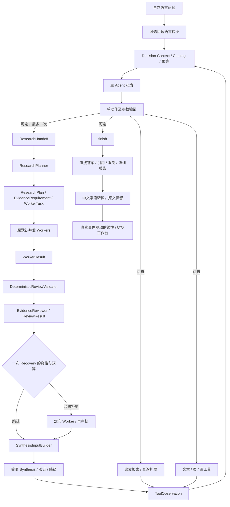

# 系统架构与能力边界

更新：2026-10-11，G4.3 发布整理。当前默认用户入口是 [app.workbench](../../app/workbench.py) 和 [scripts.launch](../../scripts/launch.py)。历史阶段原始验收报告保持不变；G1 工程清单属于当时快照，当前入口以本文及[主编排](react-workbench.md)为准。

## 1. 系统目标

从用户问题出发，在当前本地论文资源中按需发现论文、检索证据或组织多论文研究。模型解释意图、选择工具和判断语义充分性；程序负责身份、作用域、预算、执行协议和引用约束。

旧 `app.main` 的 `/api/agent/run` 保留冻结单问题入口。当前 `/api/research/runs` 不要求手动传论文 ID；`ReActWorkbenchRuntime` 复用 `BoundedToolAgent.run`，通过组合适配提供主策略和答案优先返回。旧独立研究脚本仍可重放已保存计划，不等同于当前用户入口。

## 2. 数据流

图是职责与可选数据路径，不表示每次任务执行所有节点。多 Agent 研究返回观察后，主 Agent 仍需决定最终如何回答原问题。

## 3. 核心模块与源码

| 模块 | 职责与数据 | 源码 |
|---|---|---|
| 主 Agent | 运行时选择工具或 finish；共享预算与观察反馈；非冻结协议自纠正 | [react_runtime.py](../../app/research/react_runtime.py)、[react_policy.py](../../app/research/react_policy.py)、[loop.py](../../app/agent/loop.py) |
| 研究交接 | 校验目标论文、选择来源和范围，交付当前问题、候选与剩余预算 | [research_handoff.py](../../app/research/research_handoff.py)、[research_tool.py](../../app/research/research_tool.py) |
| Planner | 生成研究维度，程序展开论文 × 维度，生成 WorkerTask | [planner.py](../../app/research/planner.py)、[requirements.py](../../app/research/requirements.py)、[models.py](../../app/research/models.py) |
| Worker | 单论文独立调查、积累观察、提交 supported 或明确不足；并发受资源槽限制 | [worker.py](../../app/research/worker.py)、[orchestrator.py](../../app/research/orchestrator.py)、[worker_protocol.py](../../app/research/worker_protocol.py) |
| Retriever | query embedding → 对应索引 → scoped Top-K；不判断证据是否充分 | [retrieval/retriever.py](../../app/retrieval/retriever.py)、[papers/retriever.py](../../app/papers/retriever.py) |
| 引用验证与审核 | 先核查 Claim / 需求 / Evidence 身份、来源与观察白名单，再审核语义支持 | [review_validation.py](../../app/research/review_validation.py)、[reviewer.py](../../app/research/reviewer.py)、[evidence/citations.py](../../app/evidence/citations.py) |
| Recovery | 仅恢复符合条件的审核拒绝，最多一轮；再次审核后合并，历史保留 | [recovery_orchestrator.py](../../app/research/recovery_orchestrator.py)、[recovery_merge.py](../../app/research/recovery_merge.py) |
| Synthesis | 只使用已审核事实，模型组织合法结构，程序保留权威正文与缺失矩阵 | [synthesis_input.py](../../app/research/synthesis_input.py)、[synthesis_runtime.py](../../app/research/synthesis_runtime.py)、[synthesis_validator.py](../../app/research/synthesis_validator.py) |
| 公开结果与工作台 | 答案优先 DTO、任务管理、公开事件、中文阅读版、只读回放 | [answer_first.py](../../app/research/answer_first.py)、[run_manager.py](../../app/research/run_manager.py)、[workbench 架构](workbench.md) |

## 4. 论文与证据世界

本地 Paper Catalog 是 25 篇元数据，不是全部论文全文。Prepared Corpus 是 5 篇、46 条文本、5 条 Figure Evidence；固定 PDF、页序号、人工区域和裁剪、图注与原始来源哈希建立可追溯关系。

Paper Index 与 Evidence Index 独立。`search_papers` 返回候选元数据和可用性；模型选择合法候选 ID 后调用 `search_text` 或研究工具。`read_page` 不会临时解析未准备页；元数据-only 论文保留缺失，不制造正文 Evidence。

已有 `analyze_figure` 可以通过 Evidence ID → Resolver → FigureAnalyzer 联合图片、Caption、Text Context 调用 VLM。当前默认研究评测主要依据文本 / 图注，Reviewer 不读取像素；工作台展示图片不能证明图像模型已调用。没有实时外部论文检索、自动全文解析或图像向量检索。

## 5. 证据准入与回答保障

- 单 Agent `finish` 的 Evidence ID 必须是本次实际观察过的证据，不能引用假 ID。
- Worker Claim 必须属于自身论文且满足其引用观察白名单；`supported` 仍是待审核结果。
- Synthesis 的 VerifiedClaim 必须同时满足 supported、确定性验证通过和精确匹配的 Reviewer passed。身份冲突、未知证据、重复审核均 fail-closed。
- `insufficient_evidence / review_rejected / review_unavailable / execution_failed / cancelled` 保留差异，模型不能升级为 verified。
- 单 Agent 直接证据回答没有自动调用 Reviewer；研究 Claim 经审核，也不代表主 Agent 新写的跨论文总结或中文翻译已独立审核。

引用真实性、结构合法、模型语义审核和独立人工事实核验是不同层级。当前没有完成独立人审的大规模研究质量 Gold Benchmark。

## 6. 执行边界与恢复

| 层级 | 当前约束 |
|---|---|
| 主 Agent | 6 个领域工具上限，7 次主决策上限；最多 2 次协议纠正，共用决策额度 |
| 全请求 | 最多 200 次物理模型 / VLM 调用与 64 次实际工具；可由 API 降低模型预算 |
| 子研究 | 目标 1–3 篇，最多启动一次；预留一次主 Agent 返回决策，不给子链新额度 |
| Worker / 资源并发 | Worker 3、LLM 2、VLM 1、Retrieval 1；原 ResourceGate、线程适配与有界 retry |
| 初始 Worker | 模型预算 20、实际工具 8、协议纠正 2 |
| 研究 Recovery | 最多一轮；只为合格语义拒绝项调查，再经过 Reviewer |
| Synthesis | 有界结构纠正；失败保留 verified facts 和明确 generation_degraded |
| 工作台 | 单进程、运行 1 / 排队 2；420 秒软超时，等待在途线程清理 |

Provider transient retry、动作协议自纠正、研究语义 Recovery 分别处理，不能互相冒充。空结果是正常业务观察；依赖失败、执行失败与取消不能包装成证据不足。协议违规批次不执行，Controller 不代替模型挑一个动作。

## 7. 实验与指标边界

F3.1 `CoverageAwarePaperWorker` 是显式可选实验，默认 `WorkbenchRuntime` 仍用原 Worker。它没有被本次发布默认启用；其已知失败集质量 / 成本权衡见[实验汇总](../reports/experiment-summary.md)。

ResolutionRate、EvidenceCoverage、ReviewPassRate、ReportGenerationSuccessRate 分母不同。合法不足可以是 resolved，但不是 verified；报告生成成功不能替代事实覆盖率。历史 Stage E、F2、F3.1-E 和 G2.1 的样本与配置不合并推导统一性能提升。
