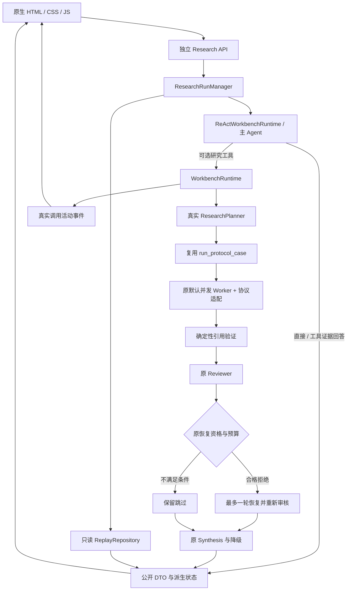

# 工作台架构与事件契约

本文更新至 G4.3。工作台在冻结研究链外增加接口和运行管理，不改变各研究模块的语义规则。旧 `app.main`、原 API/UI 和历史数据不变；新入口为 [app.workbench](../../app/workbench.py)，启动为 [scripts.launch](../../scripts/launch.py)。

Worker 在原资源 Gate 内并发。引用校验在语义审核之前；Validator 无独立生命周期回调，只展示原 validation_status。合法空 Claim 也可通过结构门槛，但不产生已审核事实。

## 模块

| 新模块 | 职责 |
| --- | --- |
| [research_runs.py](../../app/api/research_runs.py) | 专用 HTTP 接口，不承担研究决策。 |
| [run_manager.py](../../app/research/run_manager.py) | 后台任务、限流、重复拦截、内存历史和取消。 |
| [run_events.py](../../app/research/run_events.py) | 事件契约、敏感字段删除和路径脱敏。 |
| [run_presenter.py](../../app/research/run_presenter.py) | 真实结果投影，不生成事实。 |
| [run_replay.py](../../app/research/run_replay.py) | 固定历史文件白名单及来源 SHA256。 |
| [workbench_dependencies.py](../../app/research/workbench_dependencies.py) | 只读语料/SQLite绑定/缓存/配置检查。 |
| [workbench_runtime.py](../../app/research/workbench_runtime.py) | 原资源与重试适配、真实 Planner 和研究链、物理调用账本。 |
| [静态界面](../../app/workbench_web/index.html) | 轮询和公开事实展示，不选择工具。 |

当前研究主要使用 Prepared 文本与图注。Figure Evidence 展示和 VLM 工具路径不表示本阶段验证了像素级推理。

## API

| 方法与路径 | 用途 |
| --- | --- |
| `GET /api/research/papers` | Prepared 论文与本地 Catalog 元数据，可用性分别标记。 |
| `GET /api/research/health` | UI / replay / real readiness。 |
| `POST /api/research/runs` | 只需 question；可选 1–3 个 Catalog paper_ids 与 max_model_calls 1–200；202。 |
| `GET /api/research/runs/{run_id}` | 状态、取消请求、成本和报告可用性。 |
| `GET /api/research/runs/{run_id}/events?after=0` | 严格递增序号与 next_cursor，旧事件不重复返回。 |
| `GET /api/research/runs/{run_id}/report` | 公开报告 DTO 或真实部分诊断，无事实时不补写。 |
| `POST /api/research/runs/{run_id}/cancel` | 传播取消，等待实际收尾。 |
| `GET /api/research/replays` / `POST /api/research/replays/{case_id}` | 固定历史案例与只读加载。 |

不接受任意路径、地址、密钥或命令；422 不回显非法输入，内部异常不回传堆栈。诊断采用字段投影，不直接序列化整个领域对象或 SDK 响应。

## 事件来源

RunEvent 字段为 run_id / event_id / timestamp / node_type / node_id / status / event_type / summary / details / source。

| source | 来源 | 时间与解释 |
| --- | --- | --- |
| live | 真正发生的 Planner 生命周期、模型或检索回调。 | 记录观察时间；模型返回不代表动作已执行或 Agent 已完成。 |
| derived | 本次返回的 Plan、Worker、Review、Recovery、Report。 | 缺原时间时 null，不编造阶段起止。 |
| replay | 固定历史文件推导的展示状态。 | 本轮不研究、不检索，缺时间保持 null。 |

Worker 实时身份只取原协议 Schema 中程序绑定的单论文 enum；实际单论文检索按真实 scope 绑定。无法确认时显示聚合活动，不解析问题猜论文。模型 proposal 只公开合法动作名/数量，未校验参数不直接转发，原响应仍交给原 Controller。

Validator/Reviewer 卡片汇总逐需求记录，不是新增生命周期。not_reviewable＋insufficient_evidence 显示 skipped，真正审核依赖故障仍是 failed。Recovery 只在原条件满足时执行，初始历史与恢复后合并结果分别保留。

## 状态与取消

queued → running → completed / failed / cancelled。研究 completed 不保证全部需求通过；回放 completed 仅表示文件加载完毕。报告、Worker、审核、缺失项的终态独立展示。

运行1、排队2、历史20条/1小时、每任务事件1000条，不多进程共享。只淘汰终态，活跃任务不会被回放覆盖；相同活跃问题/论文不能通过变更预算重复启动。

总体模型预算限制调用，不判断语义充分性。物理请求开始前扣减，包括重试和 VLM；model_calls_observed = llm_calls_observed + vlm_calls_observed，drain 后更新，避免取消前快照少计在途调用。历史计数保留原 LLM Provider 口径，model_calls_scope 明示，不再重复加 VLM。

原 Semaphore / offload / Retry 保留。420 秒等待超时触发取消，在途线程真实结束后释放资源和关闭 client；Manager 收尾后设置终态，保留取消/超时快照。Ctrl+C 取消活跃及排队任务，不伪装为证据不足。

## 安全与验证边界

启动与回放不加载模型或创建付费请求；SQLite使用mode=ro。仅真实提交才以create=False打开既有collection并加载本地模型。新工厂用local_files_only=True提供原Qwen实例组件，复用原embedding方法，不改变query instruction、归一化或排名。

前端使用textContent，论文和报告不能执行为HTML。报告只来自原ResearchReport，损坏引用显示report_invalid；未审核草稿不拼入最终事实。证据保留report_snapshot，当前Corpus匹配状态与模型passed/人审分别标记。

工程测试、浏览器历史回放、实际启动验证分别记录；本阶段没有新的Provider研究。见 [使用指南](../guides/ui-quickstart.md) 与 [验收报告](../acceptance/stage_g4_1/acceptance_report.md)。

## 当前默认交互与展示

用户只输入问题，论文目录是只读资源展示。主 Agent 依据观察选择普通工具或研究工具；API 不负责选择论文。结果先呈现 direct_answer、引用和 limitations，再展开 detailed_report。

当前静态前端根据实际事件自动选择线性轨迹 / 多 Agent 树。ResearchTool 或已记录的研究角色触发协作图；Worker、Validator、Reviewer 按公开论文或需求归属分支；未归属审核保留公共分支，未执行 Recovery 与缺失占位不伪装成真实节点。节点更新和点击详情均复用既有事件，不新增或改写研究动作。历史树是回放，不能证明本次实时执行。

默认调用预算与协议自纠正详见[主 Agent 架构](react-workbench.md)，新环境要求见[Quickstart](../guides/quickstart.md)。
