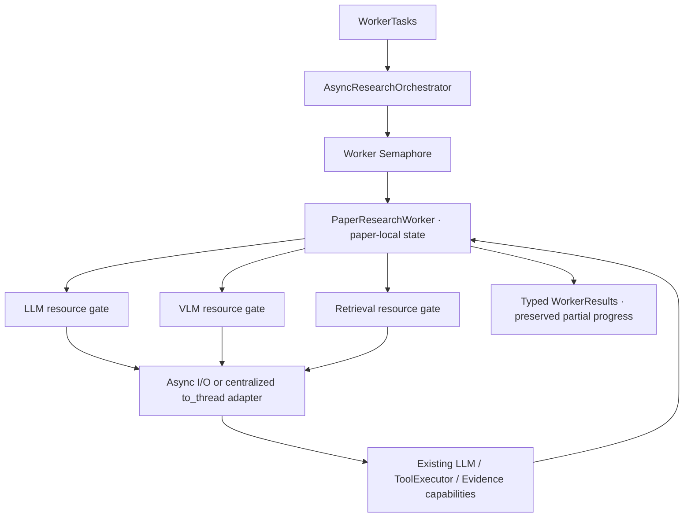

# 有界异步 Research Worker Pool

输入为已经生成的 WorkerTask[]，输出为 WorkerResult[]。一篇论文一个 Worker，多个需求共享同一份 paper-local 状态和证据。不生成跨论文结论，不执行 Reviewer/Synthesis，不修改已冻结 Planner、Retriever、Profile、Expansion、工具或 API/UI。



## 模块边界

| 模块 | 职责 |
| --- | --- |
| models.py | 追加 WorkerStatus、WorkerError、WorkerTrace、WorkerResult、OrchestratorTrace，不改变原 Planner 模型 |
| worker.py | 单论文共享状态、工具循环、状态更新、scope/citation 校验和硬预算 |
| orchestrator.py | 有界并发、按输入顺序返回、故障隔离、取消快照和池统计 |
| runtime.py | Runtime Config 与独立 ResourceGate |
| retry.py | 明确失败分类、注入式退避及依赖计数 |
| async_tools.py | 原生异步直 await；集中 offload 同步 Provider/ToolExecutor |

Worker 可调用既有 search_text/find_figure/read_page/analyze_figure。内部 resolve_requirement/resolve_requirements 是需求更新动作，不是新的全局 Agent Tool，不执行检索。批量更新先完整校验再提交；同一证据可以支持多个需求。所有需求 resolved 后确定性结束，无需额外模型 finish。

## 状态与身份

supported 必须有 claim 和非空 evidence_ids；引用必须已经观察、在当前 Corpus 中存在且属于当前 Worker 的论文。成功 Tool 返回未知、越界或被改写证据属于执行故障，不能被转成业务空结果。此阶段验证身份与来源，不证明 claim 的语义支持充分性。

insufficient_evidence 是合法 resolved 结果，无 claim/证据。模型/工具依赖失败或预算耗尽则将剩余 pending 转为 execution_failed；取消转为 cancelled。已有 supported/insufficient 项保留，原任务的 paper_id、requirement ID、问题、维度和 required 不得改写。WorkerError 记录影响的 pending IDs 和公开原因。

| WorkerStatus | 含义 |
| --- | --- |
| completed | 全部需求 resolved，允许其中全部 insufficient |
| partial_success | 有 resolved 项，也有 execution_failed/cancelled 等未解决项 |
| failed | 没有有效 resolved 结果 |
| cancelled | 上层取消，至少有未完成项转为 cancelled |

## 预算与上下文

当前默认值集中在 ResearchRuntimeConfig：

| 配置 | 默认值 |
| --- | ---: |
| max_concurrent_workers | 3 |
| max_concurrent_llm | 2 |
| max_concurrent_vlm | 1 |
| max_concurrent_retrieval | 1 |
| max_tool_calls_per_worker | 8 |
| max_model_calls_per_worker | 20 |
| max_protocol_corrections | 2 |
| recent_observations | 4 |
| max_context_evidence | 20 |
| operation_timeout_seconds | 60 |
| max_retries | 2 |

共享 CPU Retriever 默认限流为 1，避免同一模型并行争抢。Worker Semaphore 限制执行槽，不等于线程数；资源槽也不等于 Worker 数。每次执行使用新的 Gate 才能得到本次资源 peak；复用 Gate 时其资源 peak 是 Gate 生命周期统计。

模型只接收未解决问题、已解决摘要、去重证据引用和最近 Observation，不接收无限增长的完整对话。上下文字符串副本有长度限制，原证据和最终 claim 不被截断。相同成功/空 lookup 不再次执行，通过 redundant_action 反馈让模型改动或复用。

Stage A 增加 requirement_states：每项显式提供 status、candidate_evidence_ids、search_attempts、last_new_evidence_count，并保留 resolved/unresolved 分区。候选关联只表达调查来源，不表示证据支持该需求；只有模型显式提交 resolution 才更新 supported/insufficient_evidence。模型在继续检索前先检查是否可以使用已有候选解决一个或多个需求。

research action 的可选 requirement_ids 只属于 Worker 本地封装，Controller 校验后剥离；缺省表示所有 pending 需求的共享调查，不修改全局 Tool Contract。每需求的新增数按候选关联计算，全局新增数按实际观察账本计算；已观察证据首次关联另一需求时允许前者为正、后者为零。search_attempts 只记实际调度的逻辑 search_text，不包括拒绝动作或 Provider 物理重试。WorkerResult.observed_evidence_ids 来自已核验的观察账本，后续 Reviewer 验证引用时不能用候选集合代替它。

tool_calls 统计进入 ToolExecutor 的物理执行尝试，重试也消耗工具预算；Controller 拒绝的参数和需求更新不计工具调用。model_calls 是保守的模型预算计数：LLM 适配调用 + analyze_figure 执行尝试，分别提供 llm_calls、vlm_tool_attempts。VLM 预处理可能在实际 client 调用前失败，因此这些数不是 Provider 计费次数；取消结果也是当时快照。VLM 重试同时受剩余模型/工具预算限制。

## 策略协议自纠错

Controller 每个决策步仍要求 exactly one action。一次响应中的多个动作整批拒绝，不选择第一个，不解析或执行其中任何工具和需求更新。零动作响应保留原来的 protocol_failure 终止语义。

多动作拒绝产生 Worker 本地的 ProtocolViolationObservation，保留 status/tool_name/summary/payload 封装；payload 明确包含 issue_code=multiple_actions、expected=exactly_one_action、actual_action_count 和简短 recovery_instruction。它进入下一轮 Decision Context 的 recent_observations；由 LLM 自行选择一个新动作，Controller 不替它做选择。

max_protocol_corrections 默认 2，表示每个 Worker 累计最多提供两次反馈后的纠正机会；第三次多动作以 protocol_correction_exhausted 终止。0 表示首次违规立即终止。合法动作不会重置纠正计数，remaining_budget.protocol_corrections 显示剩余额度。原模型预算依然是硬上限，每次被拒绝的响应已经消耗模型调用；不会额外赠送模型额度，也不消耗工具额度。

Trace 拒绝条目包含 status=rejected、execution_status=not_executed、issue_code、实际动作数和预算快照；随后第一个合法单动作标记 protocol_recovery=true，表示动作数量已恢复合规，具体业务结果仍由该动作的 status 表达。WorkerTrace.protocol_corrections 单独统计已提供的纠正机会，不包含超限后最后一次拒绝，不计入 RetryRate/retry_count。不保存模型 response.content、被拒绝动作列表或隐藏思维链。

纠正额度或模型预算耗尽后，只将尚未解决的需求标为 execution_failed；已经 supported/insufficient_evidence 的结果继续保留，按已有规则返回 partial_success 或 failed。该机制是 Agent Policy Recovery，不调用 HTTP/Provider RetryPolicy；瞬态重试、Semaphore、线程 offload、超时和取消逻辑保持原样。

## 重试和取消

RetryPolicy 只对 Timeout/Connection、HTTP 429/502/503 等明确瞬态失败重试。HTTP 400/401、未知输入、非法参数不做 Provider Retry；empty/insufficient 是业务结果。不能因为冻结 Observation.issue.retryable=True 就无条件重试。采用 d0×2^n+jitter，sleeper/clock/jitter 可注入；Provider 自带 retry 保持 0。

模型重试位于 LLM adapter，工具重试位于 sync ToolExecutor 的适配边界。只重试资源调用，不重跑整个 Worker。硬预算包含物理重试；预算提前限制重试次数时保留 budget_exhausted 原因。

取消 Orchestrator asyncio.Task 会取消子 Worker；Worker 先保存 last_result，池保存 last_results/trace，再重新抛出 CancelledError。普通 Exception handler 不吞掉取消，也不会因为一个普通 Worker 故障丢失其他结果。

**取消等待 asyncio.to_thread 的协程，不保证底层线程终止。** 已启动线程继续持有资源槽，实际返回后才释放；外层等待超时不会重叠启动另一次线程调用。真实 Provider 配置自己的 bounded timeout；冻结 CPU Retrieval 没有强制中断能力。关闭客户端前可 await worker.drain()。CLI 会记录取消结果后等待残留阻塞操作清理，因此退出可能仍等待已有请求到达超时；cleanup_latency_ms 单独记录。

## 使用与真实 Smoke

```python
config = ResearchRuntimeConfig()
gate = ResourceGate(config)
# factory(task) 返回私有 PaperResearchWorker，内部两个适配器共享这个 gate。
orchestrator = AsyncResearchOrchestrator(factory, config, gate)
results = await orchestrator.run(worker_tasks)
```

Runner 接受 ResearchPlan、ResearchPreparation 或既有 Planner smoke JSON 中的一个 case。不会重新生成维度，不调用 Planner。每个 Worker 私有 Provider、ToolRegistry、ToolExecutor 和状态，只共享只读语料、Resolver、冻结 TextRetriever 与 Gate。

```bash
# 仅检查计划：不读凭据、不初始化模型、不执行 Worker。
python -m scripts.smoke_async_research --plan artifacts/research-planner-smoke.json \
  --case-id planner-smoke-01 --validate-only --output artifacts/worker-plan-validation.json

# 使用者显式执行真实调用。
python -m scripts.smoke_async_research --plan artifacts/research-planner-smoke.json \
  --case-id planner-smoke-01 --env-file .env --max-workers 3 \
  --max-llm 2 --max-vlm 1 --max-retrieval 1 \
  --output artifacts/async-research-smoke.json
```

其他可调 CLI 参数包括 --max-tool-calls、--max-model-calls、--max-protocol-corrections、--max-retries、--operation-timeout。输出 Worker/requirement 状态、证据 IDs、预算/重试/错误、Worker 和资源 peaks 及延迟。

serial_estimated_latency_ms 是并行运行中各 Worker latency 的和，包含资源队列等待；actual_parallel_latency_ms 是池执行耗时。前者是代理估计，不是另跑一次串行实验，不可据此声称正式性能提升。默认 BLIP-2/LLaVA 只有发现元数据，没有 prepared 正文/图像；它们可以完成为 insufficient，不能产生伪引用。

## 指标与验证

ResolutionRate=resolved requirements/total；Coverage=supported/total；WorkerSuccessRate=completed workers/total；PartialFailureRate=(partial_success+failed)/total。取消 Worker 不归入 partial failure 分子，但仍在总 Worker 分母。RetryRate=发生重试的逻辑依赖调用/全部逻辑依赖调用，物理 retry_count 单独记录。

Worker Pool 初始实现新增 101 项 Fake/确定性测试，原有 372 项保留，当时全量 473 passed。事件屏障验证 10 tasks / cap=3 真重叠及独立 Worker/resource caps，覆盖 shared evidence、scope/citation、原子 batch、partial failure、瞬态/永久重试、注入式退避、物理预算、取消和线程资源槽保留。不依赖真实模型或实际退避 sleep。

协议恢复修复另增 19 项确定性测试，原有 473 项全部保留，当前全量 492 passed。覆盖多动作拒绝到单动作恢复、纠正次数耗尽、模型预算优先、工具预算不扣、多动作 resolution 无副作用、已有结果保留、上下文反馈和公开 Trace 安全性。Ruff、147 个 Python 文件格式检查、97 个冻结文件指纹以及原 Planner 的 11 个模型 AST 比对通过。

Worker Pool 初始验收仅验证真实 Runner 的计划模式；随后协议恢复修复采用 Fake/确定性验证，当时没有重跑真实 Worker smoke。该阶段尚无 Reviewer；不含 Synthesis、跨论文答案、Checkpoint、消息队列、ProcessPool 或新检索算法。后续独立审核见 [Reviewer 架构](evidence-review.md)。

Stage A（2026-10-08）新增 21 项确定性测试，全量 513 passed。沿用历史 planner-smoke-01 的同一问题、3 篇论文、15 条需求和 Runtime Config，max_protocol_corrections 保持 2。Flamingo 从 failed/protocol_correction_exhausted 变为 completed：5 supported，5 tool calls、9 model calls、2 protocol corrections、0 provider retry，约 26.51 秒。出现两个多动作拒绝、随后合法动作恢复以及检索新增证据为零；模型显式批量解决前 4 项，再解决最后一项。三个 Worker 都 completed，但 BLIP-2/LLaVA 共 10 项为 insufficient，不产生虚假引用。这是一次工程回归，未证明语义 claim 全部正确或行为稳定性，也未记录历史 Provider 配置用于逐值比对。
