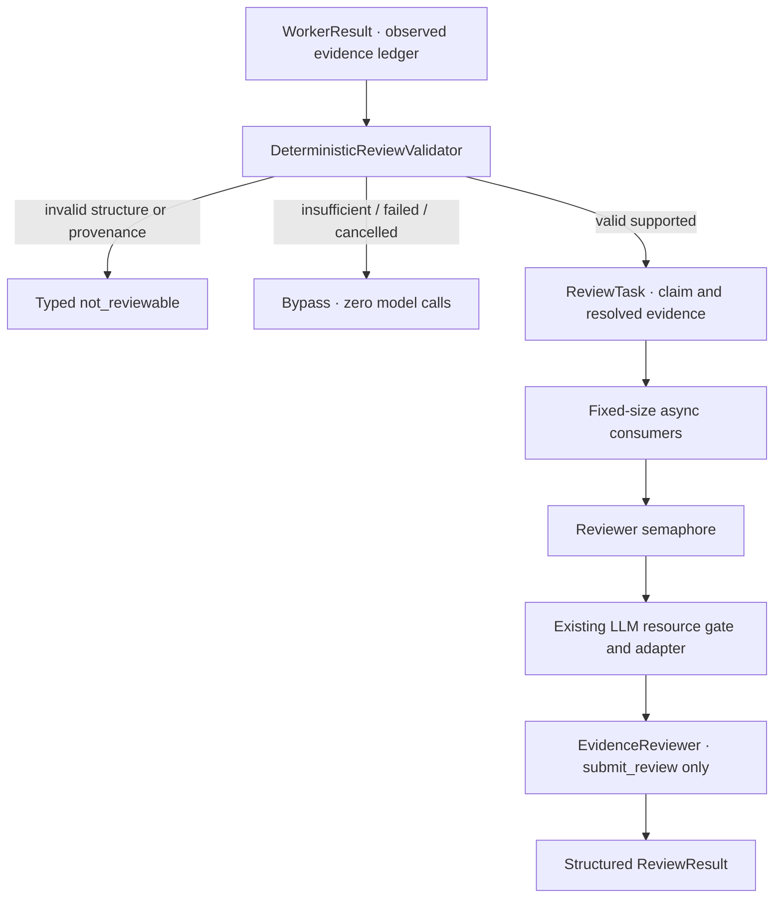

# 程序校验与证据 Reviewer

Stage B 消费现有 WorkerResult，不重新运行 Planner，不取新证据，不生成跨论文答案。Reviewer 只判断给定证据是否支持原 claim；Reviewer rejected 保留为结果，没有 Reviewer → Worker 恢复循环。



## 职责边界

| 程序校验 | Reviewer |
| --- | --- |
| requirement 结构、原身份和 paper_id | 证据是否语义支持完整 claim |
| supported 必须有非空 claim 和引用 | 完全支持 → passed |
| 每个 ID 在当前 Corpus 真实存在 | 仅部分支持 / 不支持 → rejected |
| 引用属于当前 Worker 的观察账本 | 仅使用输入证据，不用参数知识补充 |
| 引用来源同论文，证据内容从 Resolver 获取 | 不改 claim / 引用 / requirement，不搜索 |
| insufficient 无 claim/引用，执行故障和取消保持原语义 | 不负责程序可以确定的输入问题 |

`WorkerResult.observed_evidence_ids` 是 Worker 核验工具结果后写出的账本快照，不能把最终 citations 或 candidate_evidence_ids 当成已观察证据。审核可信 Runtime 的输出；外部 JSON 文件本身不提供身份认证或防篡改保证。

合法不足返回 validation_status=passed、skip_reason=insufficient_evidence，无语义 reason 或 issue。execution_failed/cancelled 直接 skipped。静态结构/来源错误返回 validation_status=rejected 的 not_reviewable 和 typed issue，不会交给模型。

Reviewer 只获得一个内部结构化动作 `submit_review(status, reason_code)`，没有 search_text/find_figure/read_page/analyze_figure。模型只能选语义结果，原 claim、身份和引用由程序绑定，不能通过输出额外字段改写。协议违规直接 not_reviewable，没有 Reviewer policy 自纠错循环。

## 结果与计数

ReviewStatus：passed、rejected、not_reviewable。reason_code 仅允许 evidence_supports_claim、evidence_partially_supports_claim、evidence_does_not_support_claim、evidence_missing、invalid_structure；跳过和执行故障没有语义 reason。程序拒绝和模型语义拒绝通过 validation_status/issue 分开表示。

ReviewResult 保存 worker_task_id、requirement_id、paper_id、原 claim、evidence_ids、status、reason_code、validation_status、skip_reason、typed issue 和 ReviewTrace。Trace 只记录物理模型调用、重试和耗时，不保存 Prompt、response.content、违规模型参数或隐藏思维链。

ReviewPoolTrace 的 reviewed_count=passed_count+rejected_count。not_reviewable_count 同时包含静态跳过、静态拒绝和审核执行故障，另用 bypassed_count 记录未调度 Reviewer 的条目，用 issue/skip_reason 区分原因。reviewable_requirement_count 是经过程序校验而可调度的 supported 数；不等于最终有效语义结果数。

## 有界执行与失败

ReviewRuntimeConfig 默认 max_concurrent_reviewers=2、max_model_calls_per_review=3。消费者数量为 min(待审核数, Reviewer 上限)，不为每条需求创建等待任务；Reviewer Semaphore 与现有 LLM ResourceGate 分别限流。每次审核使用私有 AsyncLLMAdapter，native async 直接 await，实际同步 Provider 复用原集中线程边界。

HTTP/Provider 瞬态失败使用现有 RetryPolicy，计入物理模型预算；永久失败、协议错误和语义 rejected 不重试。Provider 耗尽返回 typed not_reviewable，不能变成 evidence_does_not_support_claim。单 Reviewer 异常被隔离，不丢失同批其他结果；取消保存已有结果及调用快照后重新抛出 CancelledError。退出时先 drain 已启动阻塞操作，再关闭客户端。

peak_llm_concurrency 是所用 ResourceGate 生命周期的峰值。真实 Smoke 为审核阶段创建新 Gate，使其代表本次审核；复用已运行过的 Gate 时不能把历史峰值解释为本次结果。

## 运行工程 Smoke

先使用真实 Worker 已生成的报告，再进行审核；不是 Checkpoint/Resume，也不会继续 Worker 调查。

```bash
# 只做程序校验，不读凭据，不创建 Provider 或 Reviewer。
python -m scripts.smoke_evidence_review \
  --worker-results artifacts/async-research-smoke.json \
  --validate-only --output artifacts/review-validation.json

# 明确执行小规模真实审核；输入只使用已有 prepared evidence。
python -m scripts.smoke_evidence_review \
  --worker-results artifacts/async-research-smoke.json --env-file .env \
  --max-reviewers 2 --max-llm 2 --max-model-calls 3 \
  --output artifacts/evidence-review-smoke.json
```

Reviewer 只需要 LLM 配置，不调用 VLM。Figure 输入提供已准备的 text/caption/metadata，不包含图片像素，也不声称完成了新的视觉核验。需要不可见像素才能支持的 claim 不能凭模型记忆通过。

本阶段不含 Synthesis、最终跨论文答案、Reviewer→Worker 循环、Checkpoint/Resume、工作流引擎、额外检索算法或 API/UI 改动。Fake 验证保证工程约束；少量真实 Smoke 不是语义正确率或模型性能 Benchmark。

## 2026-10-08 验收

Stage B 新增 69 项确定性测试（Validator 17、Reviewer 26、Runtime 24、CLI 2）；加上 Stage A 21 项，原有 492 项保留，全量 582 passed。Ruff、157 个 Python 文件格式检查及 101 个冻结文件指纹通过；Planner 原有 11 个模型保持不变。

同一 Stage A Worker 输出包含 15 条需求，其中 Flamingo 5 supported 通过确定性校验后接受真实 Reviewer 审核，5 passed、0 rejected，5 次模型调用、0 Provider retries；Reviewer/LLM 峰值均为 2，耗时约 9.02 秒。其余两篇共 10 insufficient_evidence 全部 bypass，0 模型调用。not_reviewable_count=10 在此全部指合法静态跳过，没有 Provider execution issue。该次结果不证明长期稳定性或审核正确率，也不触发 Worker 重新调查。
