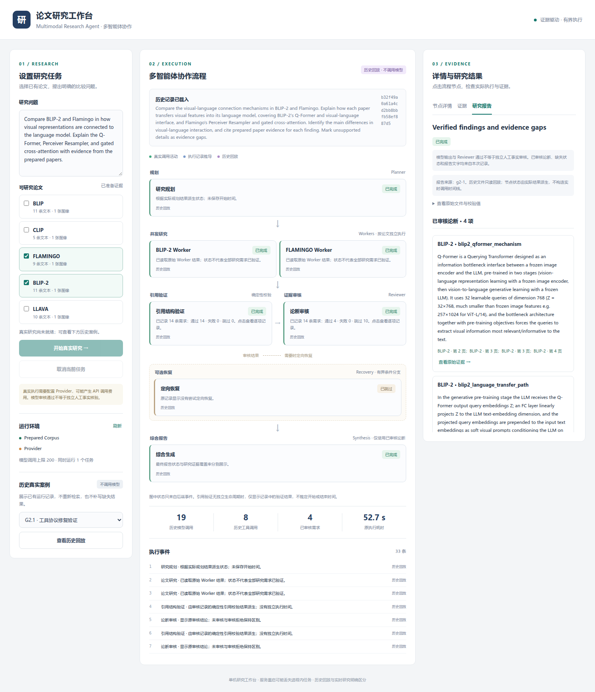
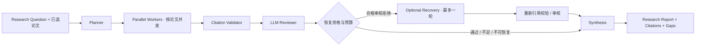

# Multimodal Research Agent · 多模态论文研究智能体

**面向多篇多模态论文的证据驱动 Multi-Agent 系统：规划问题、按论文检索、验证引用、审核论断，再生成保留证据缺口的研究报告。**

当前主要研究人工准备的 PDF 文本及图注，不将这些研究评测宣称为已验证的像素级视觉推理。Web工作台支持真实研究入口与零Provider历史回放；工程通过不等于研究结论经过独立人工核验。

**[启动与使用](#快速开始) · [工作台展示](showcase.md) · [技术亮点](highlights.md) · [简历与面试](resume-and-interview.md) · [技术报告](../reports/technical-report.md)**

## 项目展示



截图来自G4.1真实页面，**source=replay**：原G2.1的4个已审核论断与10个证据缺失单元，没有重新执行研究或修改原报告。页面的模型次数与耗时是历史值，不能当作本轮调用。更多Worker错误、原页码证据及来源见 [展示说明](showcase.md)。

## 系统架构



模型决定语义问题；Controller验证身份、Schema、观察范围和预算。引用结构校验在语义审核之前；Recovery是条件分支，恢复后的新论断必须重新审核。细节见 [系统架构](../architecture/system-overview.md) 与 [工作台事件模型](../architecture/workbench.md)。

## 核心能力

- **研究规划与并发执行**：Planner生成维度，程序投影Paper × Dimension需求，按论文分配有界Worker，共享资源限流。
- **证据检索与身份验证**：固定PDF/区域及来源哈希、稳定Evidence ID、论文过滤、页码/图号追溯；有正文的研究语料是5篇/46文本/5图像，25篇元数据目录不是25篇可研究PDF。
- **审核和综合**：确定性引用/观察账本校验与模型Reviewer分开；仅合法且审核通过的Claim进入综合，缺失和拒绝状态保留，不用模型知识补齐。
- **有界失败处理**：工具/模型预算、单动作协议纠正、明确瞬态依赖重试、一轮定向Recovery、取消与在途drain；Synthesis失败可确定性降级。
- **可观察工作台**：独立Research API、真实活动/派生状态/历史回放三类来源，按论文Worker节点，报告与证据面板。
- **可追溯评测**：保存原始执行、标签来源、AI辅助语义评分、成本和已知失败；不靠Fake结果证明研究质量。

## 快速开始

在源码仓库根目录，已有可用环境可直接激活。新环境使用Python≥3.11和现有依赖组：

```bash
python -m venv .venv
source .venv/bin/activate
python -m pip install -e '.[test,retrieval,vision,llm,data,api]'
python -m scripts.launch --check
python -m scripts.launch
```

打开 **http://127.0.0.1:8000/**，用Ctrl+C停止。端口冲突可加`--port 8001`。启动命令和地址已由G4.1源码及实际服务日志核验；G4.2再次只读检查与回放，不发起新付费研究。

**先看历史案例也可以。** 缺少Provider Key仍能启动UI、加载已有G2/G2.1回放，真实提交禁用。启动/回放不加载模型、不下载、不重建索引或调用Provider。

真实提交需要根目录`.env`或进程环境中的`LLM_API_KEY / LLM_MODEL / LLM_BASE_URL`及对应三个`VLM_*`字段，进程环境优先；参考 [.env.example](../../.env.example)，不要覆盖已有配置。真实提交可能产生费用，首次提交才离线加载已有Qwen缓存；只读就绪不代表Provider连通性已经验证。

已有项目复用Prepared Corpus与`research-stage-e-text`索引。新机器的语料、来源、缓存与索引准备见 [开发指南](../guides/development.md) 和 [UI快速开始](../guides/ui-quickstart.md)。不要混用旧单问题索引与研究索引：

| 操作 | 副作用 |
| --- | --- |
| `scripts.launch --check`、历史回放 | 只读，不发模型/检索请求，不写索引。 |
| `scripts.prepare_paper_fixture / prepare_research_corpus` | 写prepared文件；需固定PDF版本，不能当只读检查。 |
| `scripts.ingest_corpus --execute / ingest_papers` | 加载Embedding、写索引；首次依赖/模型准备可能下载，`ingest_papers --enrich`还会调用LLM。 |
| `evaluate_cross_paper --execute / --execute-retrieval` | 可能初始化/更新研究collection并运行真实检索或研究，不是本次发布启动步骤。 |

这些准备命令不是首次回放的必经操作；本轮没有执行它们。按源码checkout运行，不承诺原V0.1 wheel已经包含新静态目录与scripts。

## 实验结果：分母与边界保留

| 已有实验 | 核验结果 | 可支持的结论与限制 |
| --- | --- | --- |
| F2 | 90条AI参考任务通过79/90（87.78%）；跨论文比较8/15（53.33%）。 | 混合模块/完整链任务，AI辅助参考，独立人审Gold为0；不是人审正确率。 |
| F3.1-E | 原七条已知失败中，Coverage实验严格可接受4/7。 | 非盲诊断集，模型85→101、工具26→29；有改善、遗漏和执行失败，不代表未知数据泛化，未默认替换Worker。 |
| G2→G2.1 | 一次前后真实记录多动作错误4→0、参数错误8→0。 | Planner重新生成，12→14需求；新14合法终态含10不足、比较仍0，不能解释为研究正确率提高。 |
| G4.1工程 | 1,155项测试通过、84项新增；真实历史浏览器与统一启动通过。 | 没有新的真实Provider研究；Fake链只证实工程行为。 |

以上采用 [G3实验汇总](../reports/experiment-summary.md) 的口径；G4.2只复核，不重新评测或改标签。完整三系统RAG/Agent对照尚未完成，没有“Agent普遍优于RAG”的结论。

**发布测试口径：** 本机1,155项包含原有12项未跟踪诊断测试，按要求不自动上传。已跟踪源码的1,143项在现有依赖及研究索引环境全部通过；其中一项检查既有本地SQLite索引，新机器需先准备该索引，不能把缺环境当算法失败。另已从干净Git源码副本（无`.env`、无索引）验证UI与历史回放正常，使用的是本机已有依赖环境，不是全新依赖安装测试。见 [干净源码与测试口径记录](../acceptance/stage_g4_2/clean_source_check.json)。

## 已知限制

没有独立人工事实审核；模型Reviewer会漏判，结构性引用有效不等于语义支持。当前Prepared文本/图注有限，不支持任意PDF自动图表解析或已验证的像素推理；复杂比较可能不足或失败。工作台是单机进程内任务管理，重启会丢失当前任务，不能多进程共享；取消需等待线程收尾。**新UI的真实Provider提交尚未经过新的付费端到端演示，历史回放不等于实时研究。**

## 文档导航

| 内容 | 文档 |
| --- | --- |
| 架构与实现 | [系统总览](../architecture/system-overview.md) / [工作台架构](../architecture/workbench.md) |
| 安装与使用 | [开发指南](../guides/development.md) / [UI快速开始](../guides/ui-quickstart.md) |
| 研究分析 | [技术报告](../reports/technical-report.md) / [实验汇总](../reports/experiment-summary.md) / [设计决策](../reports/design-decisions.md) |
| 真实案例 | [G2演示](../demos/blip2-vs-flamingo/README.md) / [G2.1验证](../acceptance/stage_g2_1/acceptance_report.md) / [回放来源](../demos/workbench-replay.md) |
| 展示与求职 | [工作台展示](showcase.md) / [技术亮点](highlights.md) / [简历与面试](resume-and-interview.md) |
| 本地发布验收 | [Stage G4.2](../acceptance/stage_g4_2/acceptance_report.md) |

本页是当前发布主页。根 [README](../../README.md) 仍保留Stage E冻结历史快照；[PROJECT.md](../../PROJECT.md) 和 [文档导航](../README.md) 提供当前入口。发布标签为`v0.1.0-research-agent`，以本地Git附注标签及最终交付记录为准。
