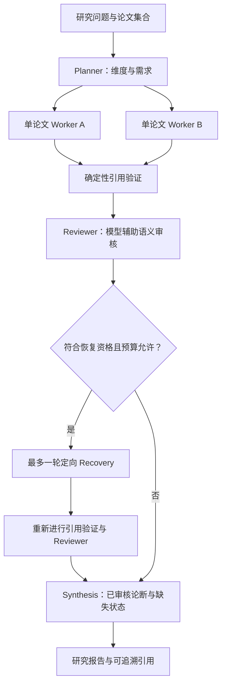
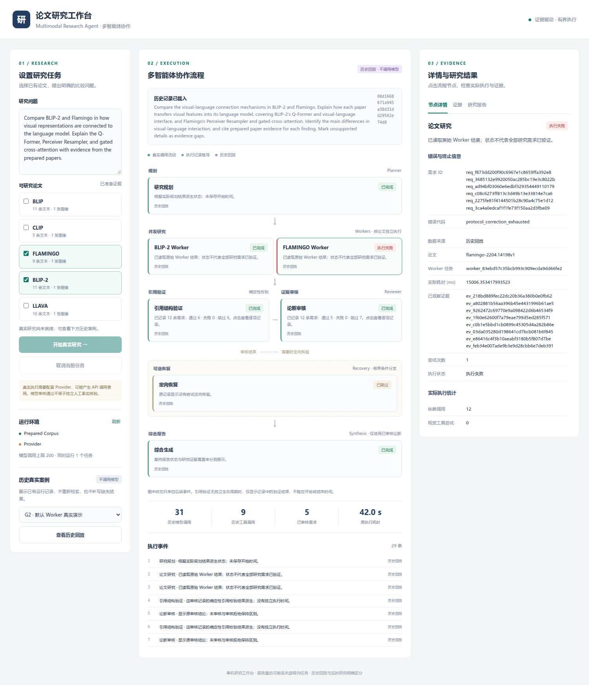
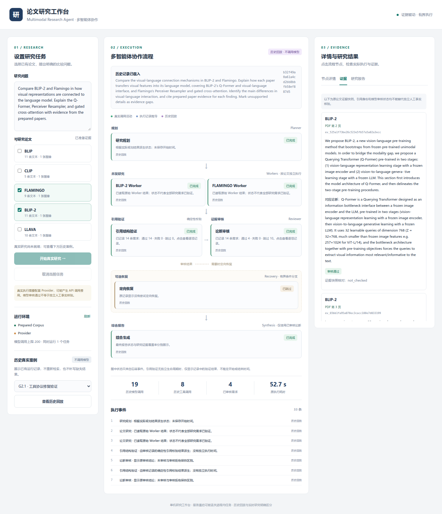

# 多智能体论文研究工作台：真实界面展示

工作台把研究问题、按论文执行的 Worker、引用校验、模型审核、条件恢复和最终报告放在同一页面。它展示后端实际记录，不以界面动画替代执行，也不通过展示层补写缺失的论文事实。

**本页三张截图均来自 Stage G4.1 已验证的真实页面，展示 G2 / G2.1 历史运行记录，事件来源为 `source=replay`。** 加载这些记录不调用 Provider、不检索、不执行新的研究；图中的模型调用次数和耗时是原实验数据。[截图来源与 SHA256](images/sources.json)、[原浏览器验证记录](../acceptance/stage_g4_1/browser_check.json)均可核查。

## 1. 工作台整体


*来源：Stage G4.1 浏览器检查中保存的 G2.1 页面截图，原图原样复制，`source=replay`。本轮展示未调用 Provider。*

三栏对应三种操作：

- **左栏设置任务**：输入问题，选择当前有正文证据的论文，检查运行条件；也可以选择历史案例。
- **中栏查看协作**：按论文并列的 Worker、引用验证、Reviewer、条件 Recovery 和 Synthesis。节点可点击，执行事件保留来源。
- **右栏检查依据与结果**：查看 Worker 需求、工具动作、错误、原论文证据与报告。

图中的 G2.1 记录包含 **4 个已审核论断、10 个证据不足单元、0 个跨论文比较**；原模型调用 **19 次**、工具 **8 次**、耗时约 **52.7 秒**。两名 Worker 合法结束，不代表所有研究需求都获得事实答案。图中 Provider 被浏览器验证入口明确禁用，因此“开始真实研究”呈禁用状态；这不是本次验证发现的服务故障。[原始结果与限制](../acceptance/stage_g2_1/acceptance_report.md)

## 2. 配置研究任务

统一入口是 `python -m scripts.launch`，实际应用为 [`app.workbench`](../../app/workbench.py)。旧 `app.main` 单问题应用与其 API 仍保留。安装、配置和语料索引准备见 [UI 快速开始](../guides/ui-quickstart.md) 和 [开发指南](../guides/development.md)。

当前可选列表来自真实 Prepared Corpus：**CLIP、BLIP、Flamingo、BLIP-2、LLaVA，共 5 篇论文、46 条文本证据、5 条图像证据**。页面允许选择 2–3 篇；Paper Discovery 的 25 篇元数据目录不等于这 5 篇正文语料。

1. 输入明确的研究问题，选择对应论文。
2. 查看运行环境。就绪检查核对配置、已有模型缓存、Corpus 和索引绑定，不发送付费探测请求；它不证明 Provider 已连通。
3. 点击“开始真实研究”才会提交真实任务，并可能产生 API 费用。示例和默认问题只预填，不自动执行。
4. 无 Provider Key 也可进入工作台，在“历史真实案例”中点击“查看历史回放”。

**回放时，中栏显示原始历史问题；左栏输入框仍用于下一次真实任务。** 两处措辞可能不同，不能把左侧预填问题当作历史运行的原始请求。

## 3. 并行研究与条件恢复



引用身份与归属校验先于语义审核；Recovery 是条件分支，不能从普通箭头推断它每次都会执行。实际运行使用原默认 `PaperResearchWorker` 与 G2.1 协议适配，不启用实验性 F3.1 Coverage Worker。

节点和事件区分三种来源：

| 来源 | 表达的事实 | 不代表什么 |
| --- | --- | --- |
| `live` | 本次实际生命周期、模型或检索调用活动。 | 模型返回不代表动作已经执行或研究成功。 |
| `derived` | 从本次 Plan、Worker、Review、Recovery、Report 推导的状态。 | 未记录的逐阶段时间不会被补造。 |
| `replay` | 从既有历史文件加载的展示记录。 | 不代表现在正在调用模型或并发研究。 |

Validator 没有独立生命周期时，卡片只汇总原 `validation_status`；缺少时间显示无记录。并列 Worker 表达系统按论文组织任务，本页历史截图不作为新的实时并发测量。[事件契约与资源边界](../architecture/workbench.md)

## 4. Worker 失败详情



*来源：Stage G4.1 已提交的 G2 截图，`source=replay`。截图中的失败属于原 G2 真实实验，不是本轮回放产生的新失败。*

点击 Flamingo Worker 可查看 `protocol_correction_exhausted`、未完成需求 ID、已观察证据、实际调用统计等。Controller 没有从多个动作中悄悄选择一个执行；协议耗尽后的失败也没有被替换成“合理拒答”。

该历史案例保留 **5 个已审核论断、7 个缺失单元**，模型 **31 次**、工具 **9 次**、原耗时约 **42.0 秒**。研究报告可以保留其他已审核事实，报告生成完成不等于失败 Worker 的需求已经完成。[G2 原失败分析](../demos/blip2-vs-flamingo/failure-analysis.md)

详情区展示可观察执行事实，包括参数、错误类别、证据 ID 和预算统计。它不展示隐藏 Chain-of-Thought；Worker 原始提交与最终已审核论断也保持区分。

## 5. 证据、引用与审核状态



*来源：Stage G4.1 已提交的 G2.1 证据截图，`source=replay`。右侧正文来自原报告中的论文证据快照，不是前端补写的答案。*

在报告论断下点击“查看原始证据”，页面切换到“证据”页签，显示论文、PDF 页码、稳定 Evidence ID、原文本或图注及对应论断。证据路径是：

```text
报告论断 → Claim ID → Evidence ID → paper_id → PDF 页码 → 原文 / 图注
```

这里必须分别理解三个检查：

- **确定性引用校验**：核对 ID 存在、论文归属及允许引用范围。
- **Reviewer 通过**：模型辅助的语义审核结果，可能漏检事实遗漏或范围偏离。
- **独立人工事实核验**：本项目这些展示记录尚未完成此项，不由前两项自动推导。

截图中的 `corpus_check=not_checked` 表示展示层未再次对历史证据快照进行当前 Corpus 匹配检查，不是“证据已通过人工核验”。页面主要展示 prepared 文本与图注；有 Figure Evidence 并不意味着这些研究记录已经验证像素级视觉推理。

## 6. 最终报告与缺失信息

整体截图右栏是原 G2.1 报告 `Verified findings and evidence gaps`。打开“研究报告”，可查看已审核论断、引用、未完成或证据缺失单元、研究限制，以及“实际报告全文（展开查看）”。原 Markdown 以文本方式显示，展示层不改写技术结论，也不把模型内容作为 HTML 执行。

“已完成”表达报告生成状态，不能替代已审核证据覆盖率。G2.1 中 BLIP-2 与 Flamingo 的 10 个缺失单元仍明确保留；跨论文比较为 0，不能因为页面能够生成报告，就声称已完成完整连接机制比较。

回放来源可在报告里展开“查看原始文件与校验值”。G2.1 使用同次运行的 [execution-record.json](../acceptance/stage_g2_1/results/execution-record.json)、[research-report.json](../acceptance/stage_g2_1/results/research-report.json) 和 [execution-summary.json](../acceptance/stage_g2_1/results/execution-summary.json)，而非预写成功答案。[历史来源清单](../acceptance/stage_g4_1/replay_manifest.json)

## 7. 历史回放与真实执行的区别

| 项目 | 历史回放 | 真实执行 |
| --- | --- | --- |
| 入口 | “查看历史回放”。 | “开始真实研究”。 |
| 数据 | 固定、已有 G2 / G2.1 执行文件。 | 本次 Planner、Worker、审核、条件恢复与综合结果。 |
| Provider / 检索 | 不调用、不检索。 | 按真实任务和预算调用。 |
| 指标 | 原模型次数、工具次数、原执行耗时。 | 本次观测调用及耗时。 |
| 事件 | 历史记录推导，缺原时间则无记录。 | `live` 活动与 `derived` 结果分别标注。 |
| 完成状态 | 文件已载入，不表示历史研究所有需求成功。 | 流程终态与需求、审核、报告状态分别显示。 |

刷新会尝试恢复同一 `run_id`，不重新提交任务；服务重启、保留到期或任务淘汰后，内存状态可能不可用。真实任务取消会等待在途调用收尾，不能把点击取消解释为 Python 线程立即终止。工作台是单机单进程展示，不是生产分布式队列。

本页仅整理已有界面与历史事实。新 Web 入口的 Provider 提交尚未通过新的付费端到端演示；历史回放和确定性工程测试不能替代这项验证。实际研究质量与成本见 [实验汇总](../reports/experiment-summary.md)，复现历史界面见 [使用指南](../guides/ui-quickstart.md)。
