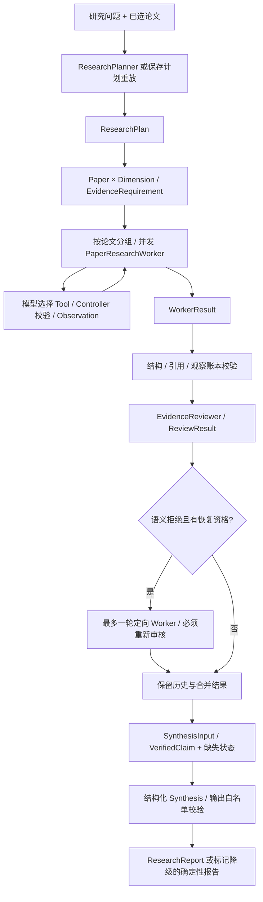

# 多模态论文研究智能体技术报告

**范围：Stage E—G2.1。事实核验日期：2026-10-10。** 本报告只整理已保存的代码、实验和运行记录；没有新Provider实验、训练、索引重建或质量调优。原始指标、分母与来源见[实验汇总](experiment-summary.md)，取舍见[技术决策](design-decisions.md)，可复核材料见[G3验收](../acceptance/stage_g3/acceptance_report.md)。

项目已实现可追溯的论文证据研究链路，但现有结果支持的是**工程可执行、失败可定位、引用身份可验证**，尚不能支持“通用自主研究”“独立人工验证的高准确率”或“协议合法即研究正确”。F2的79/90、F3.1-E的4/7、G2.1的14/14合法终态属于不同样本和指标，不形成同一条质量提升曲线。

## 1. 项目背景与研究目标

论文比较需要同时处理多个信息需求：定位本论文事实、获取相关上下文、确认引用支持范围，再把各篇已审核事实放在同一研究维度下比较。一次检索后直接生成答案不容易表达哪一篇、哪一项仍缺证据，或者错误首次发生在哪个环节。

本项目将这些职责拆开。Planner提出研究需求，Worker按论文收集证据，Reviewer审核候选论断，Synthesis仅组织获准的事实，Recovery为合格的审核拒绝提供一次定向修正。目标是让研究结果和缺口都可解释，不通过多阶段调用自动获得事实正确性。

## 2. 系统总体架构

现有两条入口必须分开：FastAPI /Web UI调用单问题`BoundedToolAgent`；多论文研究由脚本或研究库装配运行，尚未接入原API/UI。G2.1另有显式协议增强入口，旧冻结入口不会自动采用它。完整源码映射见[系统总览](../architecture/system-overview.md)。

| 模块 | 语义职责 | 程序约束与接口 |
| --- | --- | --- |
| Planner | 决定需要调查哪些维度 | [ResearchPlan](../../app/research/models.py)校验身份和结构；[需求投影](../../app/research/requirements.py)展开矩阵。中性维度是政策要求，不是完整的程序语义保证。 |
| Worker | 决定检索、读页、查图、分析或提交需求结果 | [原Worker](../../app/research/worker.py)严格单动作、单论文、硬预算和已观察引用；返回WorkerResult。 |
| Retriever | 向量搜索 | [TextRetriever](../../app/retrieval/retriever.py)和[Chroma store](../../app/retrieval/vector_store.py)在Top-K前按论文过滤；不判断问题是否已解决。 |
| Reviewer | 引用是否支持该候选Claim | [确定性入口](../../app/research/review_validation.py)先验证，再由[模型审核](../../app/research/reviewer.py)返回通过、拒绝或不可审核。 |
| Recovery | 根据合法拒绝反馈重新调查 | [资格与预算](../../app/research/recovery_eligibility.py)限制一轮，旧历史不覆盖，新结果重新审核。 |
| Synthesis | 选择章节与已核验Claim组织结构 | [输入准入](../../app/research/synthesis_input.py)、[输出校验](../../app/research/synthesis_validator.py)保管权威正文、引用和缺失项。 |

模型负责语义判断，Controller负责确定性约束。Controller不因检索成功就强制完成，也不根据论文关键词自动替模型选范围；模型决定的候选结果仍须经过程序约束。

## 3. 论文数据与证据检索

研究Prepared Corpus为5篇：CLIP、BLIP、Flamingo、BLIP-2、LLaVA，共46条TextEvidence和5条FigureEvidence。V0.1演示语料是其中3篇、25条文本、3条图像；Paper Catalog另有25篇元数据，发现某论文不意味着它已有正文证据。

数据来源链为固定PDF版本和SHA256 → 人工文本区域与Figure裁剪 → prepared文件 → Evidence ID → 原文/页码/图号。PDF页码从1开始，与印刷页码可能不同。[Corpus loader](../../app/evidence/corpus.py)验证PDF、页面、图片哈希；研究追加语料还验证来源清单与段落位置。相同身份和文本生成稳定ID；源文本变化不沿用原文本ID。

正文检索使用Qwen/Qwen3-Embedding-0.6B和独立Chroma text collection，按paper_ids过滤；论文元数据索引与它分开。索引配置绑定语料快照和模型，当前研究快照为`18fce87eb4050186aefc545a97b55d8b397108953647c5985c685102b2ea2390`。当前不是自动全文PDF解析、自动Figure检测或图像向量检索。

代码存在图片输入VLM路径，但本报告中的真实研究评测主要使用Prepared文本与图注；Reviewer的输入没有像素，相关运行VLM调用为0。这些结果不能验证像素级视觉推理质量。Figure定位和图片展示也不能作为视觉理解已成功的证据。

## 4. 多智能体协作与审核机制

Worker通常每篇一个任务，共享资源Gate，循环获得Observation后再选择下一个动作；同篇需求可共享证据。`supported`表示Worker提交了待审核Claim，不是已确认事实。`insufficient_evidence`必须保留空Claim /空引用；执行失败和取消采用不同状态。

进入Reviewer前，程序验证Evidence属于当前Corpus、当前论文和Worker观察账本，审核任务与原需求、Claim和引用精确绑定。模型审核支持的是该段Claim，不自动保证完整研究需求已经覆盖，也不是独立人工论文事实审核。

综合准入要求`支持结果 + 结构验证通过 + 精确绑定审核通过`。重复/冲突Review、未知证据或身份不匹配按fail-closed处理。拒绝的Claim正文不进入事实输入。模型可选择章节和Claim引用，原Claim文本、Evidence和缺失状态由程序组装。跨论文比较仅在同一维度具备各方合法VerifiedClaim时成立，不能靠模型知识填缺。

因此，`Claim → Evidence ID → Paper/PDF Page/Original Text`能保证追溯，但不证明该原文支持Claim的所有限定、全文否定或技术推断。

## 5. 失败恢复与安全边界

三种纠正不能混为一谈：

| 类型 | 触发与边界 |
| --- | --- |
| Provider transient retry | 明确连接、超时或短暂服务错误，原策略有界重试；永久错误与业务空结果不按此重试。 |
| Policy协议纠正 | 多动作/非法结构不执行被拒动作，由模型读反馈重新提交；消耗模型预算。原Worker多动作最多2次纠正机会，参数错误仍受模型预算约束。 |
| 研究Recovery | 仅对合格的语义审核拒绝定向恢复，最多一轮；通过结果不重做，缺少资格/预算正确跳过。 |

当前配置初始Worker模型预算20、工具8；Reviewer每需求最多3，Synthesis模型5 /协议纠正2；资源并发Worker3、LLM2、VLM1、检索1。研究脚本总预算和恢复预留见[配置](../../configs/cross_paper_eval.json)，不能把这些硬限制写成“保证在若干步内成功”。

同步依赖offload到线程。协程取消不强杀线程，资源槽直到真实调用结束才释放；等待超时不叠加仍在运行的同类调用，退出drain可能增加等待。取消、execution_failed、证据不足和Reviewer不可用各自保留。

综合生成失效可交付`generation_degraded`的确定性报告，只保留已审核事实和缺失，不冒充正常模型生成。没有VerifiedClaim是合法证据不足结果。Trace记录公开动作、错误、延迟和引用，不记录隐藏推理。

## 6. 实验设计与评测方法

本报告使用五级证据区分：

| 层级 | 可以说明 | 不能说明 |
| --- | --- | --- |
| 工程测试通过 | Fake/受控输入下接口、状态、预算、取消等行为满足断言 | 真实研究语义正确 |
| 模型输出结构合法 | 实际结果符合计划矩阵和输出Schema | 问题意图已满足 |
| 引用身份/绑定验证 | ID、论文、页码、观察范围和白名单真实一致 | 所有句子得到语义支持 |
| AI辅助语义评分 | 模型判据与AI参考集下的质量结果 | 独立人工Gold准确率或无偏泛化 |
| 独立人工事实审核 | 人类对照原论文完成并记录审核 | 本项目尚无这一级已完成的质量样本集 |

Stage E验证语料来源、检索覆盖和真实工程链。F2的90题包含30单论文Claim、30 Reviewer正负例、15比较、15边界决策，采用AI审核参考90条，人工Gold为0；其中57次完整研究链、30次直接Reviewer、3次caption-only，并非统一Agent或RAG公平对照。F3只读分析七条失败比较；F3.1先做覆盖组件Fake验收；F3.1-E只在这七条已知失败上做一次正式成对诊断。G2/G2.1各一次同主题真实运行，Planner重新生成，计划不同。

证据覆盖率=通过审核需求数/原计划需求数；合法解决率还包含insufficient，但不包含execution_failed。ReportGenerationSuccessRate只衡量生成。F2的accuracy字段是混合任务AI参考接受口径；比较各轴分数平均与整题通过是不同指标。

## 7. 主要实验结果

| 阶段与样本 | 核验结果 | 解释边界 |
| --- | --- | --- |
| E：15条核心检索问题，3篇→5篇Corpus | Macro Recall@5：24%→74%；@10：33.33%→96.67% | 增加了原来没有正文的论文，反映可用证据增加，不能归因为检索算法升级。 |
| E：真实BLIP-2 /LLaVA接口比较 | 2/2 Verified、1个结构比较、最终引用违规0 | 这是已有固定计划工程案例，不是G2主题的成功重跑，不是人工语义评分。 |
| E：真实三论文5维度 | 14/15 Verified、4个结构比较、completed | 缺失Flamingo downstream_capabilities；93.33%是审核覆盖率。22个登记Case没有全部作为真实研究执行。 |
| F2：90混合题 | AI辅助79/90（87.78%）；Claim26/30、Reviewer30/30、比较8/15、边界15/15 | 15边界含13不可答和2可答对照；不能写成15次正确拒答。 |
| F3.1-E：7条已知失败 | 严格可接受4/7；必要事实完整需求9/14→11/14，自报完整13/14 | 5题局部改善、2题混合退化；不能由已知失败集证明未知数据能力。 |
| G2→G2.1：各一次真实主题 | Worker多动作4→0，参数错误8→0，执行失败需求6→0 | 合法终态6/12→14/14，但已审核5/12→4/14；计划不同，比较均0，不证明语义质量提高。 |

这些表格只并列来源，不计算跨阶段总分。精确指针、配置、样本身份、SHA和逐项重算见[审计记录](../acceptance/stage_g3/stage_e_f2_audit.json)、[F3审计](../acceptance/stage_g3/stage_f3_audit.json)、[G2审计](../acceptance/stage_g3/g2_audit.json)。

## 8. 失败案例分析

### 案例A：引用与审核成功，BLIP-2 /LLaVA

已有Stage E输入为“Compare BLIP-2 and LLaVA in how they connect visual representations to the language model.”，case_id为two-paper-bridge。[原记录](../acceptance/stage_e_freeze/evidence/2026-10-08-多模态论文研究智能体-StageE双论文真实评测.json)重放保存的1个中性维度，两个Worker检索本论文证据，两个Claim通过结构校验与模型审核，再组成1个side-by-side比较。

两条权威Claim为`claim_d0d8319d60dbbe6670df22ad36e51865`和`claim_62875649e7c28d28a6927947a343c981`；其原文和引用与Worker/Reviewer匹配。2条Claim、7处引用分别追溯到BLIP-2 PDF Pages 2/3/4和LLaVA Pages 4/5。结果2/2已审核、最终结构引用违规0，9次模型/2次工具、约15.18秒。

该案例说明：各篇在同一维度具备审核事实时，程序可以产生可追溯结构比较。它不说明所有技术解释已经人工核实，也不证明任意计划都能获得这种结果。

### 案例B：Worker协议失败中断G2

G2输入比较BLIP-2 /Flamingo的视觉语言连接机制。[完整诊断](../demos/blip2-vs-flamingo/failure-analysis.md)显示Flamingo Steps 1/5/10返回3/4/2个actions，中间多次使用search_text不允许的paper_id。两次纠正机会后第三次拒绝，未执行多动作。

它已成功搜索并读页，观察到账本8条证据，却没有提交合法需求；6项变为execution_failed。Reviewer没有可审核Claim，Recovery资格不满足，Synthesis保留缺口；不能把报告completed称为研究完成，也不能把失败叫证据不足。BLIP-2留下5条通过Claim，比较数0。

工程启示是模型API关闭并行参数和文字承诺不能代替Controller。G2.1在不改冻结Controller的前提下增强请求契约；实际改善来自一次观测，不是可靠的长期协议错误率估计。

### 案例C：协议合法但无法比较，G2.1

G2.1使用原问题、论文、模型、配置、语料和索引，但真实Planner生成7个维度，其中包含论文专属维度。Paper × Dimension投影把Q-Former问题也交给Flamingo，把Perceiver问题也交给BLIP-2；interaction_difference还包含若干备选机制和额外性能需求。该计划在结构上合法，却不保证适合作为统一比较轴。

两个Worker无协议/Schema错误，提交4个supported和10个insufficient；Reviewer四条passed。只有BLIP-2三个维度和Flamingo一个维度有VerifiedClaim，没有任一同维度双边证据，因此比较数0。[原计划及结果](../acceptance/stage_g2_1/results/execution-record.json)未经人工修饰。

Flamingo一次检索后批量提交不足，是否过早停止尚未独立语义检验。Synthesis首次引用集合不合法被原校验器拒绝，一次纠正后通过，最终违规0。工程启示：合法终态、模型审核通过、报告生成三者都不能替代用户意图完成；规划中性、需求完整性与语义停止仍是边界，本轮不修它们。

### 诊断补充：Coverage声明并不自动带来质量

F3只读定位了七题的Worker首个质量风险；这些Claim曾被生产Reviewer通过，未发现Synthesis另造事实。F3.1-E的接口题声明language_interface covered仍漏FC/soft prompts；多阶段字段混淆导致一题非法JSON失败；训练目标一题遗漏原基线已有损失区别，还新增证据未明确支持的更新推断。已有来源的8.7%或54×数字应记无关范围漂移，不能称数字幻觉。详见[F3审计](../acceptance/stage_g3/stage_f3_audit.json)。

## 9. 系统成本与工程权衡

| 实验边界 | 模型/Provider尝试 | 工具调用 | 时间口径 |
| --- | ---: | ---: | --- |
| F2全部90题 | 456 | 107 | 863.998秒案例耗时之和，不含初始化、评分、归档；不是统一并行批次墙钟。 |
| F3.1-E正式七题基线→实验 | 85→101 | 26→29 | 内层案例总和93.528→160.709秒；计时边界、运行日期和Provider状态有混杂。 |
| G2→G2.1 | 31→19 | 9→8 | 含正式预检的封装总耗时41.96→52.69秒；含Planner，计划不同。 |

F3.1-E调用+18.82%、工具+11.54%、归档案例耗时+71.83%；另一次非正式工程冒烟7模型/2工具单列，不混入正式101。G2.1调用-38.71%而总时间+25.58%，综合额外纠正和Provider延迟都会影响墙钟。没有SDK token账单时不能虚构金额或精确归因延迟。

更严格的覆盖提交减少部分遗漏，却增加Schema负担并可能过度保守；F3.1因此保留为可选实验。协议适配降低了本次格式失败，但不会解决不合适的研究维度或证据充分性。冻结、来源绑定和失败保留牺牲了部分便捷性，换来可复核历史；详见[技术决策](design-decisions.md)。

## 10. 局限性与未来工作

目前仅5篇人工准备研究语料，无任意PDF自动研究能力；元数据25篇不是正文覆盖25篇，像素级研究质量未由上述实验验证。现有语义评分为AI辅助、非盲口径，独立人工Gold和事实审核数为0。固定失败集诊断、一次性真实演示不能提供泛化结论，规划随机性和服务alias也限制严格复现。

当前Reviewer可漏掉附加断言或需求完整性问题；结构covered和合法insufficient均可能与独立语义判断不同。Synthesis可拒绝身份/结构错误，但不能完全验证自然语言蕴含。跨阶段覆盖率、合法终态率和混合题通过率不可互换。历史manifest中的not_yet_graded等创建时字段应结合最终评分记录阅读，不静默改写原件。

未来可在另行授权与独立协议下推进：人工核验参考集和保留测试集；保持计划固定的成对诊断及语义完整性/停止评估；研究维度中性与矩阵适用性验证；资源、请求时长和token成本的更完整记录；自动PDF解析和跨模态检索另行验收。这些均为未来工作，本阶段没有实现或启动。
