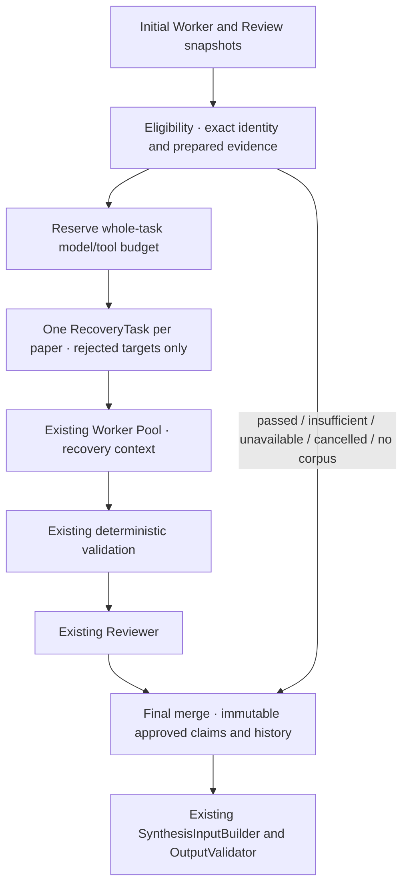

# Reviewer 反馈驱动的一次定向恢复

Stage D 只恢复具有合法、可行动反馈的明确审核拒绝。复用 PaperResearchWorker、AsyncResearchOrchestrator、EvidenceReviewRuntime 和既有 Synthesis；不实现多轮自动恢复、研究工作流引擎、Checkpoint/Resume 或 API/UI。



## 模块和契约

| 模块 | 职责 |
| --- | --- |
| recovery_models.py | Feedback、Task、Budget、History、Outcome 和一次轮数约束 |
| recovery_eligibility.py | 原计划绑定、审核真实性、可行动反馈、Prepared Evidence 和已用资格检查 |
| recovery_orchestrator.py | 全任务预算预留、按论文分组、复用原池、再次审核和可选现有综合 |
| recovery_merge.py | 每需求唯一活动结果，初始事实保护和历史归档 |
| worker.py 最小补丁 | 可选 recovery_context，恢复旧观察证据、窄目标和预算；不复制执行循环 |

RecoveryFeedback 包含 requirement_id、rejected_claim_id、reason_code、explanation、prior_evidence_ids。Feedback必须绑定精确原claim/证据及实际rejected Review，不能引用未观察或外论文证据。旧Reviewer只返回最小reason_code，因此本版解释由调用方提供；代码验证结构和身份，不宣称能判定解释在语义上一定可行动。

RecoveryTask 包含 paper_id、target_requirement_ids、reviewer_feedback、attempt_index=1、max_attempts=1、prior_result_refs、完整旧Worker/目标Review快照和剩余预算。result_ref为规范JSON内容哈希，history.record_id独立唯一；历史记录attempt 0/1、归档时间、状态及完整原结果，不把归档时间伪称旧执行开始时间。

## 资格和预算

默认仅允许 supported + validation passed + review rejected、有有效反馈、存在Prepared Evidence、未取消且额度未用。passed、一般insufficient、review_unavailable、execution_failed、cancelled、没有prepared语料和无效反馈均跳过。Prepared Evidence来自真实Corpus记录，Paper Profile不算证据机会，也不保证能解决拒绝。

RecoveryConfig 默认 max_recovery_rounds=1（严格拒绝0/2/bool），每论文Worker最多12模型/4工具尝试，每目标Reviewer最多3模型尝试，完整ResearchTask上限80模型/32工具。prior_usage必须显式声明，不能低于已有Worker/Reviewer记录；Planner、发现和既有综合等其他请求成本由调用者一并声明。离线画像索引不属于当前研究请求。

在并发前给每论文Worker和每目标再次审核分配不可重叠租约，可选现有Synthesis也预留其最大模型预算。模型重试/VLM尝试仍使用原保守计数并受租约限制；实际使用必须不超过总预留和整个请求上限。预算不足不启动恢复，不依靠并发完成顺序争抢额度，不动态回收快任务未用预算。

一个RecoveryOrchestrator实例对应一个研究请求；第二次run明确拒绝，流程也没有再次拒绝→第二轮分支。跨进程身份认证、持久化轮次和Resume不在本阶段；调用者不能把旧数据当新请求来宣称同一请求仍未花预算。

## Worker、复核和合并

Worker只收到目标pending需求和Recovery Context：拒绝原主张、反馈、已观察旧证据内容及剩余预算。旧证据再次从可信Resolver核验身份/同论文来源后进入观察账本，不恢复通过项、不使用画像。可直接缩小主张或定向检索，仍Exactly One Action、协议纠正上限2；旧主张和旧引用都完全不变时不能直接重新提交supported。新增supported必须再次进入原DeterministicReviewValidator和Reviewer。

初始合法passed永远保留原claim/Review；只有新的合法passed才能成为VerifiedClaim。再次rejected是终态，不启动第二轮。新Reviewer不可用/冲突/缺失均fail-closed；execution_failed和cancelled保留各自状态。Recovery返回insufficient只记录在独立尝试历史，最终保留此前review_rejected，避免把审核拒绝漂白成普通证据不足。

历史保留旧/新原结果，包括拒绝正文；它们是审计资料，不是事实输入。Synthesis只接收唯一最终活动Worker/Review，经原InputBuilder再验证，不能读取这些历史拒绝正文作为事实。原Evidence ID不改，旧和新观察账本按合法来源合并。

取消沿现有池/Adapter传播，保存原通过事实和恢复进度后重新抛出CancelledError。取消快照不会引用旧Reviewer或Synthesis批次来重复计费。超时、Semaphore、线程边界和RetryPolicy均复用原实现，普通Worker故障由原池隔离。

Worker、Reviewer、Synthesis必须共享同一个可信Resolver快照与ResourceGate，禁止把同ID的不同证据内容跨阶段混用。调用者提供可信历史数据仍是前提，内容hash不替代来源认证。

## 指标

eligible/attempted/passed/failed/skipped按Requirement计，同论文合并为一个Worker不改变分母。attempted表示本轮已分配/调度的目标，含执行失败，实际Provider开始次数另记。conversion=再次成为Verified的目标/attempted；无尝试为null。rounds 0或1。

additional_model_calls包括恢复Worker、再次Reviewer以及可选既有Synthesis的物理预算计数；additional_tool_calls仅恢复阶段工具尝试。recovery_latency_ms覆盖资格后执行、复核、合并和可选综合。prior_usage、reserved_budget、research_usage同时保存。Fake计数是预算模拟，不与真实Provider计费或模型性能混用。Trace/历史保存公开动作与结果，不保存模型隐藏推理。

## 三个 Smoke

共用已保存的Stage A/B原计划与真实Prepared Evidence，脚本先验证Worker源hash与Reviewer报告匹配。mode a对Flamingo架构主张注入无证据的“所有任务零错误/优于所有模型”保证，原始文件不修改；初始拒绝和Feedback是明确受控标注，再由真实Worker/Reviewer/Synthesis执行。mode b用Fake新主张+再次拒绝；mode c保持原数据，不创建无意义恢复Worker/Reviewer，综合为Scripted。

```bash
python -m scripts.smoke_research_recovery --mode a \
  --plan artifacts/research-planner-smoke.json \
  --worker-results artifacts/async-research-smoke.json \
  --review-results artifacts/evidence-review-smoke.json \
  --prior-model-calls 25 --prior-tool-calls 10 \
  --output artifacts/recovery-smoke-a.json
```

mode b/c同参数但选择相应模式。--validate-only不读凭据、不初始化Provider/Embedding，只检查资格。例中的prior数来自本次文件计数；其他研究请求必须按自身已发生调用填写，不能直接照搬。

本次Smoke A：1eligible/attempted/passed，1轮，0新增工具；真实Worker1、Reviewer1、Synthesis1模型调用，约27.57秒，研究累计模型25→28、工具10→10。Worker直接用旧证据缩小claim，去掉无依据保证，4个原通过项保持不变；报告5verified/10insufficient，20条独立历史。

Smoke B：再次拒绝，1failed/1轮，报告4verified、1review_rejected、10insufficient；拒绝正文不在SynthesisInput或最终ResearchReport，20历史。Worker/Reviewer/Synthesis各1Fake调用，真实Provider0。

Smoke C：0eligible、0恢复Worker/Reviewer调用、0轮，5verified/10insufficient保持；仅1次Scripted综合，真实Provider0。这里additional_model_calls=1来自Fake综合，不是额外研究调用。

真实成功只是受控初始拒绝下的一次工程结果，不是自然失败率、恢复泛化成功率或人类语义证明。没有扩Corpus、调Prompt/检索、提高恢复轮数或绕过复核。

验收新增57项测试，原646项保留，全量703passed；Ruff、176个Python文件formatter及195个冻结文件指纹通过，原Planner11个模型不变。唯一既有生产补丁为worker.py恢复入口，普通模式回归保留；没有修改Reviewer/Synthesis/原Pool/Adapter/Retry/检索和语料。真实脚本即使最终不检索仍初始化现有检索工具，setup耗时计入恢复延迟；本阶段不做启动性能优化。
