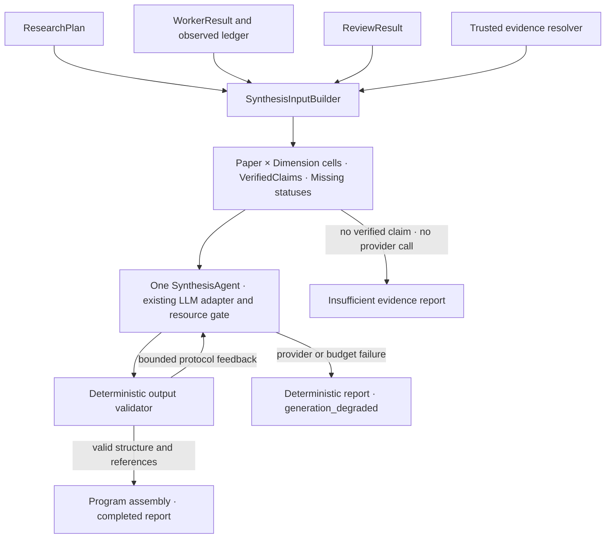

# 严格证据驱动的研究综合

Stage C 消费冻结的 ResearchPlan、WorkerResult、ReviewResult 和可信证据快照。只增加综合任务，不重新研究、检索、审核或下载论文，没有 API/UI 接入。



## 文件与职责

| 文件 | 职责 |
| --- | --- |
| synthesis_models.py | 输入矩阵、权威主张、缺失状态、受限输出协议、报告与指标 |
| synthesis_input.py | 原计划身份映射、原 Worker/Review 精确绑定、真实同论文观察证据复核 |
| synthesis_agent.py | 一次综合任务，Exactly One submit_report，独立有限协议纠正 |
| synthesis_validator.py | 每格/维度恰好一次、引用归属、状态不升级、多论文证据完整性 |
| synthesis_runtime.py | 程序装配事实、指标与最小降级报告，取消快照与传播 |
| scripts/smoke_research_synthesis.py | 消费既有真实结果，写 JSON 与可读 Markdown |

## 输入边界

只有 supported + deterministic validation passed + review passed 的精确原 claim 才成为 VerifiedClaim。再次使用冻结的 DeterministicReviewValidator 核验 Corpus 存在性、同论文来源和 Worker 观察账本；通过状态不能代替这些校验。

Requirement ID 按原计划确定性重建；worker ID、paper/dimension/question/required 均与原记录绑定。审核 claim 和 evidence_ids 必须原样匹配 Worker。缺失 Review、非法身份和未知证据默认不可用。重复 Review（包括完全相同的两个 passed）返回 typed SynthesisInputError，不挑选通过项；重复 Worker 不选一个成功结果，其计划单元标为 execution_failed。

Paper × Dimension 矩阵永远完整。insufficient_evidence、review_rejected、review_unavailable、execution_failed、cancelled 分别保留。被拒绝/未审核正文不进入 SynthesisInput，错误只携带固定公开原因和需求 ID。不会读取 Paper Profile，也不会用参数知识补事实。

这依赖可信 Runtime 快照；外部 JSON 的自述 passed/observed 状态不是来源认证。CLI 对 Stage B 保存的 Worker 来源 SHA-256 做绑定，防止混用不同运行文件，但哈希匹配不是防篡改签名。

## 第一版输出协议

模型仅获得 submit_report。每章节包含 dimension_id、受限标题、逐论文 CellSelection 和可选 side_by_side comparison。标题从固定中性词组中选择；没有自由技术摘要、claim 正文、胜负或等价判断字段。模型可调整章节/单元顺序，选择已有引用；程序组装原 claim 正文、原证据 paper/page/figure 和真实缺失状态。

每个计划维度/单元恰好出现一次。verified 格只能引用自身 VerifiedClaim 的全部 evidence_ids；缺失格不可升级、不可带引用。比较对象限定原计划，且同一维度的每篇对象必须都有合法 VerifiedClaim；不能把一个 Flamingo 主张当作 BLIP-2 的证据。第一版比较是权威主张并列，不声称生成并验证了新的自然语言技术结论。

结构校验不是语义蕴含证明。权威主张可能有 Worker/Reviewer 的语义错误；本阶段不宣称检测全部自然语言幻觉。

## 失败、纠正与取消

SynthesisConfig 默认 max_model_calls=5、max_protocol_corrections=2。每次被拒绝响应也消耗模型预算；最多两次反馈纠正机会，第三次仍非法则 protocol_correction_exhausted。Controller 不选择多个动作中的第一条，也不编造事实补齐输出。

HTTP/Provider transient failure 复用旧 RetryPolicy，永久故障不重试；物理重试计入总模型预算。模型协议纠正与 Provider retries 分开计数，不引入 Worker Pool。Provider、协议或预算失败返回 typed issue，按同一个可信输入生成 generation_degraded 报告，全部权威事实、引用和缺失格保留，不添加技术判断。

没有 VerifiedClaim 是合法业务结果：不初始化或调用 Provider，返回非空不足报告，status=insufficient_evidence，generation_degraded=false。取消则保存 status=cancelled 的事实快照并重新抛出 CancelledError，不标为证据不足或正常成功。线程行为和 drain 继续由冻结适配器管理。

## 指标口径

| 指标 | 分子 / 分母 |
| --- | --- |
| ResolutionRate | 已知 Worker supported 或 insufficient / 全部计划需求 |
| EvidenceCoverage | 有效绑定且审核通过的 VerifiedClaim / 全部计划需求 |
| ReviewPassRate | VerifiedClaim / 有效绑定的 passed + rejected |
| ReportGenerationSuccessRate | 正常 completed 模型报告 / 本次请求的模型生成任务 |

报告计数记录 total/verified/missing/rejected/resolved/reviewed，不能用生成成功率替代证据覆盖率。生成任务分母按 ResearchTask 计（一次），不按物理 API calls 计。无已审核证据时不尝试模型生成，分母为零、成功率为 null；没有有效语义审核时 ReviewPassRate 也是 null。降级/取消都不是正常生成成功。

此外记录 citation_validation_failures（引文身份/归属拒绝响应数）、synthesis_model_calls（物理尝试）、protocol_corrections（已给反馈机会）、provider_retries、synthesis_latency_ms、report_status、degraded_generation。Trace 只保存公开事件、拒绝代码和计数，不保存模型正文/隐藏思维链/坏参数。

## 使用已有文件运行

```bash
# 不读凭据、不初始化 Provider；只核验计划与来源。
python -m scripts.smoke_research_synthesis \
  --plan artifacts/research-planner-smoke.json --case-id planner-smoke-01 \
  --worker-results artifacts/async-research-smoke.json \
  --review-results artifacts/evidence-review-smoke.json \
  --validate-only --output artifacts/synthesis-validation.json

# 一次真实综合，不重新调用 Worker 或 Reviewer。
python -m scripts.smoke_research_synthesis \
  --plan artifacts/research-planner-smoke.json --case-id planner-smoke-01 \
  --worker-results artifacts/async-research-smoke.json \
  --review-results artifacts/evidence-review-smoke.json --env-file .env \
  --output artifacts/research-synthesis.json --markdown artifacts/research-synthesis.md
```

本阶段不包括研究恢复、Checkpoint/Resume、Synthesis 并发框架、开放推测、语料扩展、检索调优或正式 Benchmark。真实 Smoke 只验证工程链路；受控 Fake 失败单独标记，不能当作真实 Provider 故障证据。

## 2026-10-08 验收记录

新增64项确定性测试，全量646 passed。Ruff、167个Python文件格式和171个既有Stage A/B文件指纹通过，原Planner的11个模型不变。覆盖审核冲突、缺失/错误关联、引用伪造、单方缺证比较、正文不可改、有限纠正、物理预算/Provider重试、取消、无已审核事实和确定性降级。

使用原plan及Stage A/B真实报告：三篇论文、五维度、十五单元；Flamingo五条原始主张与全部引用保留，BLIP-2/LLaVA十格仍为insufficient_evidence，没有完整跨论文技术比较。一次真实调用约10.49秒，status=completed，0 citation rejection、0协议纠正、0 Provider retry；ResolutionRate=15/15，EvidenceCoverage=5/15，ReviewPassRate=5/5，ReportGenerationSuccessRate=1/1。没有人工核验或Benchmark结论。

受控Fake验证复用同一真实输入，三次输出虚构引用均被拒绝，最多两次纠正机会，最终protocol_correction_exhausted；报告generation_degraded，保留原五条主张、十格缺失和真实引用，不交付伪引用。Fake model_calls=3，真实Provider调用0；生成成功率0/1而证据覆盖仍5/15，不能混入真实模型性能统计。
